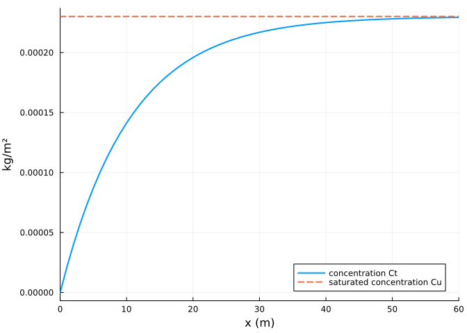
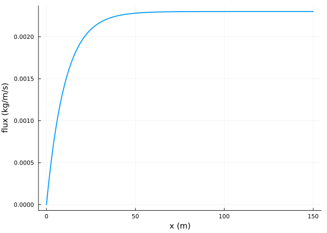
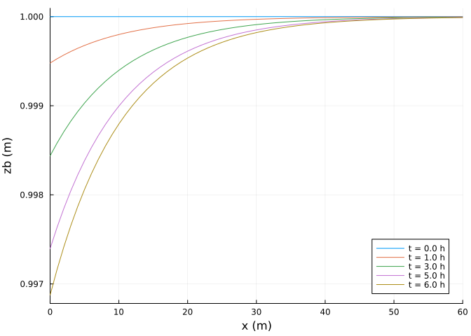
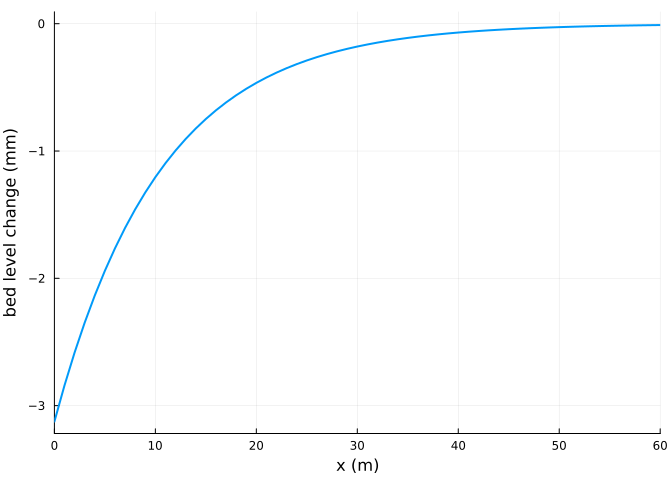

# Getting started
Simon Frost

- [Overview](#overview)
- [A transect](#a-transect)
- [Solving](#solving)
- [Fetch](#fetch)
- [Bed change](#bed-change)
- [Stepping](#stepping)
- [References](#references)

## Overview

AeoLiS models the wind-blown transport of sand over a bed whose supply
of loose sediment can be limited ([Hoonhout and de
Vries 2016](#ref-Hoonhout2016)). Sand in the air relaxes towards
a saturated concentration set by the wind’s shear velocity, and the sand
that moves is taken from, or added to, the top layer of the bed. This
vignette sets up the simplest case, a dry transect under a steady wind,
and introduces the problem, solution and plotting interface.

``` julia
ENV["GKSwstype"] = "100"
using Aeolis
using Plots
```

## A transect

A model is described by `AeolisParameters`, whose keywords have the
names of an AeoLiS configuration file. The grid is a vector of
cross-shore positions (`xgrid_file`) with a bed level for each
(`bed_file`); the wind is a time series with columns time (s), speed
(m/s) and direction (degrees, nautical: 270 is wind from the west,
blowing towards increasing x).

``` julia
x = collect(0.0:1.0:150.0)
zb = fill(1.0, length(x))
p = AeolisParameters(; xgrid_file=x, bed_file=zb,
                     wind_file=[0.0 10.0 270.0; 86400.0 10.0 270.0],
                     grain_size=0.0003, dt=600.0, tstop=6 * 3600.0, output_times=3600.0,
                     output_vars=[:zb, :Ct, :Cu, :qs, :pickup, :ustar])
```

    AeolisParameters
      time: 0.0 to 21600.0 s, dt = 600.0 s
      scheme: euler_backward, solver: trunk
      fractions: 1, layers: 3
      enabled: process_wind, process_transport, process_bedupdate, process_threshold, th_grainsize

Unset parameters take the AeoLiS defaults; `parameter_info` lists them
with their units.

``` julia
filter(r -> r.name in (:T, :Cb, :Aa, :k, :z, :nlayers, :layer_thickness), parameter_info())
```

    7-element Vector{NamedTuple{(:name, :type, :default, :unit, :description)}}:
     (name = :nlayers, type = Int64, default = 3, unit = "-", description = "Number of bed layers")
     (name = :layer_thickness, type = Float64, default = 0.01, unit = "m", description = "Thickness of bed layers")
     (name = :Aa, type = Float64, default = 0.085, unit = "-", description = "Constant in the grain size threshold")
     (name = :z, type = Float64, default = 10.0, unit = "m", description = "Measurement height of wind velocity")
     (name = :k, type = Float64, default = 0.001, unit = "m", description = "Bed roughness")
     (name = :Cb, type = Float64, default = 1.5, unit = "-", description = "Constant in the Bagnold formulation")
     (name = :T, type = Float64, default = 1.0, unit = "s", description = "Adaptation time scale in the advection equation")

## Solving

`AeolisProblem` wraps the parameters and a time span, and `solve` runs
it with the scheme and transport solver named by the parameters (here
the AeoLiS default, implicit Euler with the trunk solver):

``` julia
prob = AeolisProblem(p)
sol = solve(prob)
```

    AeolisSolution with 7 output times from 0.0 to 21600.0 s, retcode Success
      saved: Ct, Cu, pickup, qs, ustar, zb

Like AeoLiS, output is saved at the start and whenever `output_times`
seconds have passed. A transect is run as a grid of three identical
rows; `transect` returns the middle row of a saved variable, with time
as the last dimension.

``` julia
Ct = transect(sol, :Ct)        # (x, fraction, time)
size(Ct), sol.t
```

    ((151, 1, 7), [0.0, 3600.0, 7200.0, 10800.0, 14400.0, 18000.0, 21600.0])

## Fetch

Sand enters the air at the upwind end with no sediment in it and the
concentration grows towards saturation over a distance set by the
adaptation length `u T`: 10 m here, since by default grains move at the
wind speed and `T = 1 s`. Downwind of a few adaptation lengths the wind
carries as much sand as it can and the bed neither erodes nor accretes.

``` julia
Cu = transect(sol, :Cu)
plot(x, Ct[:, 1, end]; lw=2, label="concentration Ct", xlabel="x (m)", ylabel="kg/m²")
plot!(x, Cu[:, 1, end]; lw=2, ls=:dash, label="saturated concentration Cu")
xlims!(0, 60)
```



The flux is the concentration times the grain velocity:

``` julia
qs = transect(sol, :qs)
plot(x, qs[:, 1, end]; lw=2, xlabel="x (m)", ylabel="flux (kg/m/s)", label="")
```



## Bed change

The sand comes from the upwind part of the transect, which erodes; the
plot recipe draws a saved variable along a transect at several output
times.

``` julia
plot(sol, :zb; xlims=(0, 60), legend=:bottomright)
```



``` julia
dz = transect(sol, :zb)[:, end] .- transect(sol, :zb)[:, 1]
plot(x, 1000 .* dz; lw=2, xlabel="x (m)", ylabel="bed level change (mm)", label="",
     xlims=(0, 60))
```



The erosion stays near the upwind boundary because downwind cells are
saturated. The eroded mass is close to the mass that left the downwind
end, estimated here from the hourly saved fluxes (the model steps every
ten minutes, so the estimate is rough):

``` julia
rhob = p.rhog * (1 - p.porosity)
eroded = -sum(dz) * rhob                    # kg per metre width, cells of 1 m
outflow = sum(qs[end, 1, 2:end]) * 3600.0   # flux at the last cell, hourly samples
(eroded=round(eroded; digits=1), outflow=round(outflow; digits=1))
```

    (eroded = 54.7, outflow = 49.7)

## Stepping

`init` returns an integrator that can be advanced step by step;
`integ[:zb]` reads a state variable and assigning to it changes the
state.

``` julia
integ = init(prob)
step!(integ, 3)
integ.t, maximum(integ[:Ct])
```

    (1800.0, 0.00023007615354468503)

## References

```@raw html
<div id="refs" class="references csl-bib-body hanging-indent">
```

```@raw html
<div id="ref-Hoonhout2016" class="csl-entry">
```

Hoonhout, Bas M., and Sierd de Vries. 2016.
“A Process-Based Model for Aeolian Sediment Transport and Spatiotemporal
Varying Sediment Availability.” *Journal of Geophysical Research: Earth
Surface* 121: 1555–75. <https://doi.org/10.1002/2015JF003692>.

```@raw html
</div>
```

```@raw html
</div>
```
