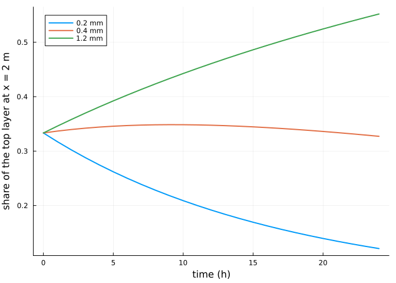
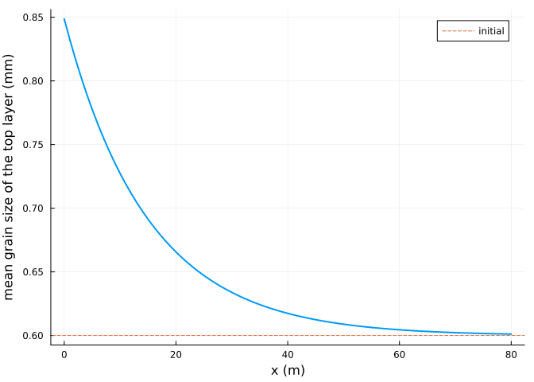
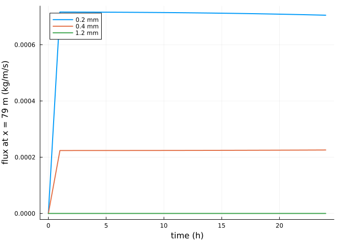
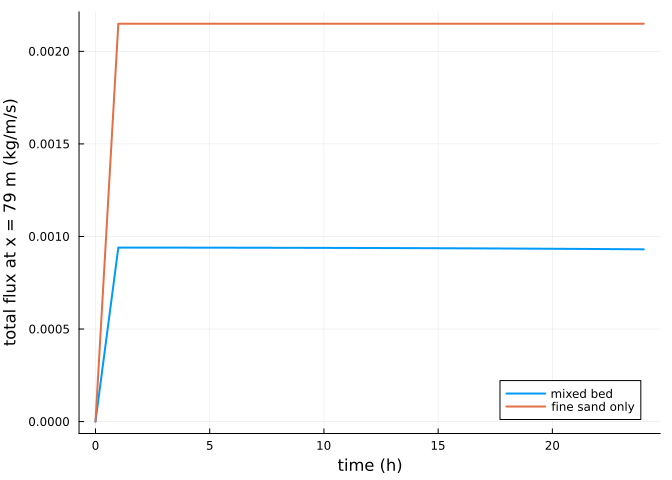

# Sediment sorting and armouring
Simon Frost

- [Overview](#overview)
- [A mixed bed](#a-mixed-bed)
- [The top layer coarsens](#the-top-layer-coarsens)
- [Supply falls as the bed armours](#supply-falls-as-the-bed-armours)
- [References](#references)

## Overview

A natural beach holds a mixture of grain sizes. AeoLiS represents it
with several sediment fractions in a stack of bed layers
([Hoonhout and de Vries
2016](#ref-Hoonhout2016)): fine grains, with a lower threshold, are
blown away first, the top layer coarsens, and once it is armoured with
grains the wind cannot move, the supply of sand falls even though plenty
remains below. This vignette follows that process on a flat transect.

``` julia
ENV["GKSwstype"] = "100"
using Aeolis
using Plots
```

## A mixed bed

Three fractions of 0.2, 0.4 and 1.2 mm in equal proportions. At a wind
speed of 9 m/s the shear velocity exceeds the thresholds of the two
finer fractions but not that of the coarsest:

``` julia
d = [0.0002, 0.0004, 0.0012]
x = collect(0.0:1.0:80.0)
p = AeolisParameters(; xgrid_file=x, bed_file=fill(2.0, length(x)), grain_size=d,
                     grain_dist=[1 / 3, 1 / 3, 1 / 3], nlayers=5, layer_thickness=0.005,
                     wind_file=[0.0 9.0 270.0; 86400.0 9.0 270.0], dt=600.0,
                     tstop=24 * 3600.0, output_times=3600.0,
                     output_vars=[:zb, :mass, :qs, :uth, :ustar])
sol = solve(AeolisProblem(p))
uth = transect(sol, :uth)[1, :, 2]
ustar = transect(sol, :ustar)[1, 2]
(thresholds=round.(uth; digits=3), ustar=round(ustar; digits=3))
```

    (thresholds = [0.175, 0.248, 0.429], ustar = 0.401)

## The top layer coarsens

The mass of each fraction in the top layer, upwind (x = 2 m), over time:

``` julia
mass = transect(sol, :mass)      # (x, layers, fractions, time)
share = mass[3, 1, :, :] ./ sum(mass[3, 1, :, :]; dims=1)
plot(sol.t ./ 3600, permutedims(share); lw=2, xlabel="time (h)",
     ylabel="share of the top layer at x = 2 m",
     label=permutedims(["$(1000d[k]) mm" for k in 1:3]))
```



The mean grain size of the top layer along the transect at the end:

``` julia
mtop = mass[:, 1, :, end]
dmean = vec(sum(mtop .* permutedims(d); dims=2) ./ sum(mtop; dims=2))
plot(x, 1000 .* dmean; lw=2, xlabel="x (m)", ylabel="mean grain size of the top layer (mm)",
     label="")
hline!([1000 * sum(d) / 3]; ls=:dash, label="initial")
```



## Supply falls as the bed armours

The flux of each fraction at the downwind end:

``` julia
qs = transect(sol, :qs)
plot(sol.t ./ 3600, permutedims(qs[end - 1, :, :]); lw=2, xlabel="time (h)",
     ylabel="flux at x = 79 m (kg/m/s)", label=permutedims(["$(1000d[k]) mm" for k in 1:3]))
```



A bed of fine sand only, with the same threshold-exceeding wind, keeps
its supply:

``` julia
fine = solve(AeolisProblem(remake_parameters(p; grain_size=[0.0002], grain_dist=[1.0])))
plot(sol.t ./ 3600, vec(sum(qs[end - 1, :, :]; dims=1)); lw=2, label="mixed bed",
     xlabel="time (h)", ylabel="total flux at x = 79 m (kg/m/s)")
plot!(fine.t ./ 3600, transect(fine, :qs)[end - 1, 1, :]; lw=2, label="fine sand only")
```



## References

```@raw html
<div id="refs" class="references csl-bib-body hanging-indent">
```

```@raw html
<div id="ref-Hoonhout2016" class="csl-entry">
```

Hoonhout, Bas M., and Sierd de Vries. 2016.
“A Process-Based Model for Aeolian Sediment Transport and Spatiotemporal
Varying Sediment Availability.” *Journal of Geophysical Research: Earth
Surface* 121: 1555–75. <https://doi.org/10.1002/2015JF003692>.

```@raw html
</div>
```

```@raw html
</div>
```
