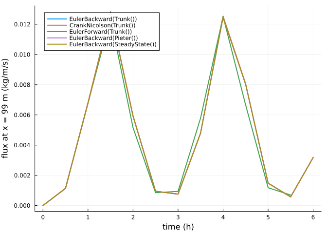

# Numerical schemes and solvers
Simon Frost

- [Overview](#overview)
- [A test problem](#a-test-problem)
- [Schemes and solvers](#schemes-and-solvers)
- [Linear solvers](#linear-solvers)
- [References](#references)

## Overview

The concentration in the air is advanced by a numerical scheme, chosen
as the algorithm passed to `solve`: implicit Euler (`EulerBackward`, the
AeoLiS default), `CrankNicolson`, or explicit Euler (`EulerForward`,
with the time step limited by the CFL number). Inside a scheme the
transport solver is `Trunk` (an upwind discretisation solved as a sparse
linear system), `Pieter` (a finite-volume form with fluxes on cell
faces) or `SteadyState` (an upwind sweep that finds the equilibrium with
the current wind). The sparse systems are solved with LinearSolve.jl, so
any of its sparse factorizations can be used.

``` julia
ENV["GKSwstype"] = "100"
using Aeolis
using LinearSolve
using Plots
```

## A test problem

A beach with a varying wind, so that the concentration is not always in
equilibrium:

``` julia
x = collect(0.0:1.0:100.0)
t = 0.0:600.0:86400.0
wind = hcat(t, 8 .+ 6 .* sin.(t ./ 3000.0) .^ 2, fill(270.0, length(t)))
p = AeolisParameters(; xgrid_file=x, bed_file=fill(1.0, length(x)), wind_file=wind,
                     grain_size=0.0003, dt=300.0, tstop=6 * 3600.0, output_times=1800.0,
                     output_vars=[:zb, :qs], CFL=1.0)
prob = AeolisProblem(p)
```

    AeolisProblem with tspan (0.0, 21600.0)
    AeolisParameters
      time: 0.0 to 21600.0 s, dt = 300.0 s
      scheme: euler_backward, solver: trunk
      fractions: 1, layers: 3
      enabled: process_wind, process_transport, process_bedupdate, process_threshold, th_grainsize

## Schemes and solvers

``` julia
algs = ["EulerBackward(Trunk())" => EulerBackward(Trunk()),
        "CrankNicolson(Trunk())" => CrankNicolson(Trunk()),
        "EulerForward(Trunk())" => EulerForward(Trunk()),
        "EulerBackward(Pieter())" => EulerBackward(Pieter()),
        "EulerBackward(SteadyState())" => EulerBackward(SteadyState())]
sols = Dict(name => solve(prob, alg) for (name, alg) in algs)
plt = plot(; xlabel="time (h)", ylabel="flux at x = 99 m (kg/m/s)", legend=:topleft)
for (name, _) in algs
    s = sols[name]
    plot!(plt, s.t ./ 3600, transect(s, :qs)[end - 1, 1, :]; lw=2, label=name)
end
plt
```



The explicit scheme takes many more steps, since the CFL number limits
its time step to the time the wind takes to cross a cell; the solution
statistics count the time steps and the matrix solves:

``` julia
[(name, get(sols[name].stats, :time, 0), get(sols[name].stats, :matrixsolve, 0))
 for (name, _) in algs]
```

    5-element Vector{Tuple{String, Int64, Int64}}:
     ("EulerBackward(Trunk())", 73, 73)
     ("CrankNicolson(Trunk())", 73, 73)
     ("EulerForward(Trunk())", 232179, 0)
     ("EulerBackward(Pieter())", 73, 72)
     ("EulerBackward(SteadyState())", 73, 0)

The bed level after six hours differs by less than a millimetre between
the time-dependent schemes; the steady-state solver, which ignores the
time the concentration takes to adjust, differs by a few millimetres:

``` julia
ref = transect(sols["EulerBackward(Trunk())"], :zb)[:, end]
[(name, maximum(abs.(transect(sols[name], :zb)[:, end] .- ref))) for (name, _) in algs]
```

    5-element Vector{Tuple{String, Float64}}:
     ("EulerBackward(Trunk())", 0.0)
     ("CrankNicolson(Trunk())", 1.3388266431046958e-6)
     ("EulerForward(Trunk())", 0.0006005299166618183)
     ("EulerBackward(Pieter())", 1.2569002748152869e-5)
     ("EulerBackward(SteadyState())", 0.005272247071415048)

## Linear solvers

The trunk and pieter solvers assemble one sparse matrix per fraction and
time step and solve it repeatedly while the fraction weights are
adjusted to the available sediment; the factorization is reused across
these solves. A LinearSolve.jl algorithm can be given with `linsolve`:

``` julia
for lin in (nothing, KLUFactorization(), UMFPACKFactorization())
    s = solve(prob, EulerBackward(Trunk(); linsolve=lin))
    d = maximum(abs.(transect(s, :zb)[:, end] .- ref))
    println(rpad(string(something(lin, "default")), 30), " max difference ", d)
end
```

    default                        max difference 0.0
    LinearSolve.KLUFactorization(true, true) max difference 0.0
    LinearSolve.UMFPACKFactorization{@NamedTuple{}}(true, true, NamedTuple()) max difference 1.1102230246251565e-16

## References
