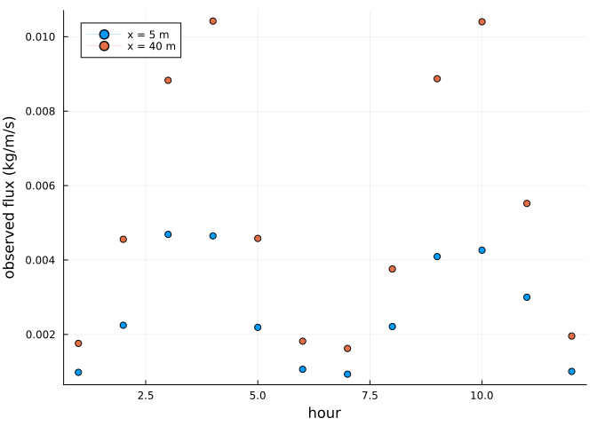
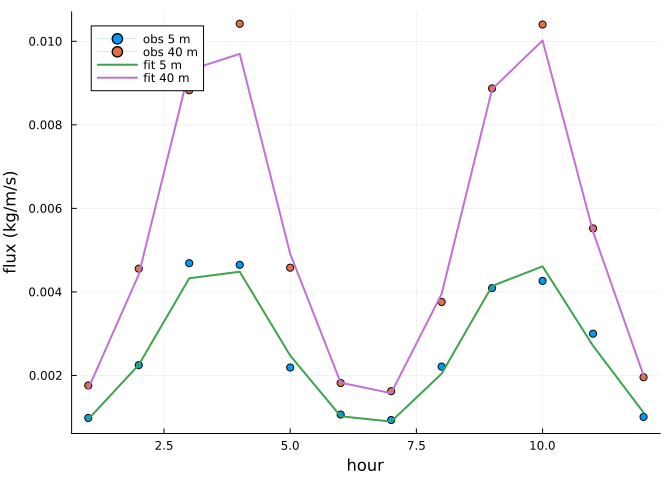

# Calibration
Simon Frost

- [Overview](#overview)
- [Observations](#observations)
- [Objective](#objective)
- [Fitting](#fitting)
- [References](#references)

## Overview

Transport constants such as Bagnold’s `Cb` and the adaptation time `T`
are rarely known for a site and are calibrated against measurements.
Because an `AeolisProblem` can be remade with new parameters, any
optimiser can drive it; this vignette fits `Cb` and `T` to synthetic
observations of sand flux with Optimization.jl and a derivative-free
Nelder-Mead search from Optim.jl; the model’s iterations for supply
limitation make its output piecewise smooth in the parameters, so a
method without gradients is a robust choice.

``` julia
ENV["GKSwstype"] = "100"
using Aeolis
using Optimization
using OptimizationOptimJL
using Plots
using Random
```

## Observations

A flat sandy transect with two flux sensors: one at x = 5 m, inside the
zone where the flux is still adapting to the wind, and one at x = 40 m,
where it is saturated. The “true” parameters are `Cb = 1.8` and
`T = 0.6` s; the observations are hourly fluxes with 5 % noise.

``` julia
x = collect(0.0:1.0:60.0)
t = 0.0:1800.0:86400.0
wind = hcat(t, 9 .+ 4 .* sin.(t ./ 7000.0) .^ 2, fill(270.0, length(t)))
base = AeolisParameters(; xgrid_file=x, bed_file=fill(2.0, length(x)), grain_size=0.0003,
                        wind_file=wind, dt=900.0, tstop=12 * 3600.0, output_times=3600.0,
                        output_vars=[:qs])
prob = AeolisProblem(base)
sensors = [6, 41]
model_flux(Cb, T) = transect(solve(remake(prob; Cb, T)), :qs)[sensors, 1, 2:end]
truth = model_flux(1.8, 0.6)
rng = Xoshiro(1)
obs = truth .* (1 .+ 0.05 .* randn(rng, size(truth)))
plot(1:size(obs, 2), permutedims(obs); marker=:circle, lw=0, xlabel="hour",
     ylabel="observed flux (kg/m/s)", label=["x = 5 m" "x = 40 m"])
```



## Objective

The sum of squared relative errors; parameters are optimised on a log
scale so they stay positive:

``` julia
function loss(θ, _)
    Cb, T = exp.(θ)
    pred = model_flux(Cb, T)
    return sum(abs2, (pred .- obs) ./ (obs .+ 1e-6))
end
[(T=T, loss=round(loss(log.([1.8, T]), nothing); sigdigits=3)) for T in (0.1, 0.3, 0.6, 1.0, 2.0)]
```

    5-element Vector{@NamedTuple{T::Float64, loss::Float64}}:
     (T = 0.1, loss = 11.1)
     (T = 0.3, loss = 2.97)
     (T = 0.6, loss = 0.102)
     (T = 1.0, loss = 1.04)
     (T = 2.0, loss = 4.55)

## Fitting

``` julia
f = OptimizationFunction(loss)
op = OptimizationProblem(f, log.([1.0, 2.0]))
res = solve(op, NelderMead(); maxiters=150)
fitted = exp.(res.u)
(Cb=round(fitted[1]; digits=3), T=round(fitted[2]; digits=3), loss=res.objective)
```

    (Cb = 1.748, T = 0.598, loss = 0.08233236790948349)

``` julia
pred = model_flux(fitted...)
plot(1:size(obs, 2), permutedims(obs); marker=:circle, lw=0, label=["obs 5 m" "obs 40 m"],
     xlabel="hour", ylabel="flux (kg/m/s)")
plot!(1:size(obs, 2), permutedims(pred); lw=2, label=["fit 5 m" "fit 40 m"])
```



The sensor inside the adaptation zone carries the information about `T`,
and the sensor where the flux is saturated the information about `Cb`.
With sensors only far downwind, the flux is saturated everywhere they
measure and `T` cannot be identified.

## References
