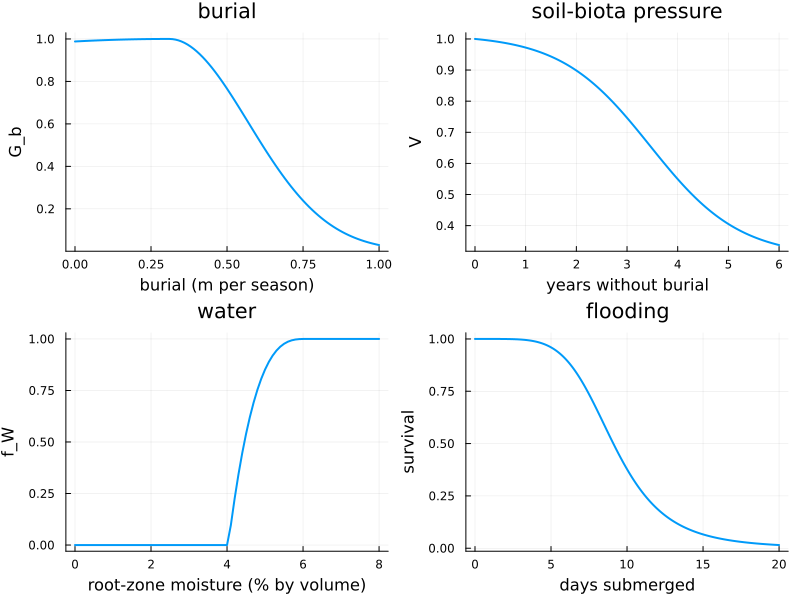
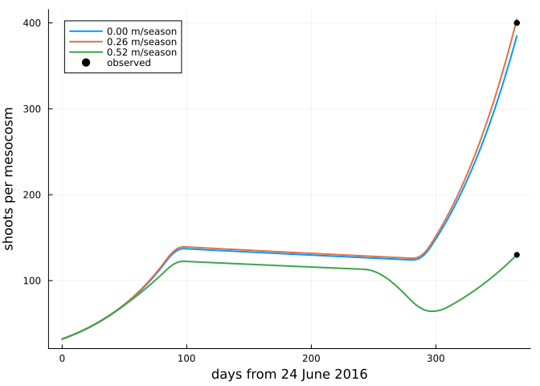
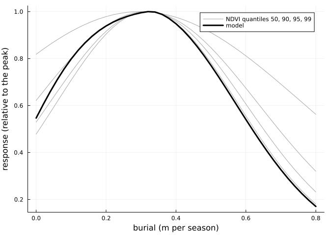
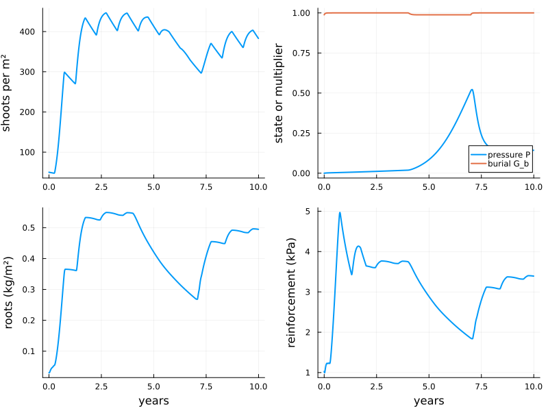

# Marram grass in one cell
Simon Frost

- [Overview](#overview)
- [Traits and evidence](#traits-and-evidence)
- [The process functions](#the-process-functions)
- [Calibration experiments](#calibration-experiments)
  - [Burial in a mesocosm](#burial-in-a-mesocosm)
  - [Burial in the field](#burial-in-the-field)
  - [Drought, flooding and heat](#drought-flooding-and-heat)
- [Ten years of a stand](#ten-years-of-a-stand)
- [What is not yet known](#what-is-not-yet-known)

## Overview

Marram grass (*Calamagrostis arenaria*, formerly *Ammophila arenaria*)
builds the foredunes of north-west Europe. It grows fastest when it is
buried by about 0.3 m of sand per growing season
([Nolet et al. 2018](#ref-Nolet2018)). It
declines where sand stops arriving, because root-feeding nematodes and
pathogens build up in the sand around its roots
([van der Putten et al.
1993](#ref-vanderPutten1993); [van der Stoel et
al. 2002](#ref-vanderStoel2002)).

Aeolis.jl has a model of marram grass in one grid cell. Each process is
a small function of the traits, with its source and evidence grade in
its docstring. This vignette:

- shows the process functions;
- re-runs the published experiments to which the traits were calibrated;
- follows a stand for ten years as sand supply changes.

The grid model, which couples the cell to wind shear and dune erosion,
comes later.

``` julia
ENV["GKSwstype"] = "100"
using Aeolis
using Dates
using Plots
using Printf
const A = Aeolis
tr = MarramTraits()
```

## Traits and evidence

The traits are listed by `marram_info`. Each has a unit, a range, a
source, and an evidence grade:

- **M**: measured on marram;
- **D**: derived from measurements, here mostly by the calibration
  below;
- **P**: a prior without a direct measurement.

``` julia
info = marram_info()
for g in (:M, :D, :P)
    println(g, ": ", count(r -> r.evidence == g, info), " traits")
end
for r in info[[4, 5, 6, 7, 8]]
    @printf("%-12s %6.3g %-12s %s  %s\n", r.name, r.default, r.unit, r.evidence, r.source)
end
```

    M: 31 traits
    D: 15 traits
    P: 19 traits
    burial_window     30 day          P  Nolet2018
    burial_opt     0.31 m/season     M  Nolet2018
    burial_c_lo       2 m/season     D  Reijers2021
    burial_c_hi    0.26 m/season     M  Nolet2018
    r               6.3 1/year       D  Reijers2021

## The process functions

Four of the processes, as functions of their driver:

- **Burial:** growth responds to the rate of burial in m per growing
  season, the unit used by Nolet et al.
  ([2018](#ref-Nolet2018)). Above the optimum it falls with Nolet’s
  width.
- **Soil-biota pressure:** without burial, pressure builds up slowly at
  first. It costs a quarter of the vigour after three years, and it is
  why the field response of Nolet et al.
  ([2018](#ref-Nolet2018)) falls below the optimum. Vigour lowers both
  the growth rate and the shoot density the roots can sustain.
- **Water:** stress acts through the root zone, with the thresholds of
  Homberger et al.
  ([2026](#ref-Homberger2026)).
- **Flooding:** survival falls with days of continuous submergence in
  seawater ([Aptekar and Rejmánek 2000](#ref-Aptekar2000)).

``` julia
d = 0:0.01:1.0
p1 = plot(d, [A.burial_response(x, tr) for x in d]; lw=2, legend=false,
          xlabel="burial (m per season)", ylabel="G_b", title="burial")
yrs = 0:0.05:6
p2 = plot(yrs, [A.vigour(A.pressure_step(0.0, 0.0, y * 365.25, tr), tr) for y in yrs];
          lw=2, legend=false, xlabel="years without burial", ylabel="V",
          title="soil-biota pressure")
θ = 0:0.001:0.08
p3 = plot(100θ, [A.water_stress(x / tr.porosity, tr) for x in θ]; lw=2, legend=false,
          xlabel="root-zone moisture (% by volume)", ylabel="f_W", title="water")
D = 0:0.1:20
p4 = plot(D, [A.flood_survival(x, tr) for x in D]; lw=2, legend=false,
          xlabel="days submerged", ylabel="survival", title="flooding")
plot(p1, p2, p3, p4; layout=(2, 2), size=(800, 600))
```



## Calibration experiments

`marram_experiment` re-runs each experiment and returns the model’s
numbers next to the published ones.

### Burial in a mesocosm

Reijers et al. ([2021](#ref-Reijers2021))
buried tussocks in 6.25 m² mesocosms of fresh sand by 0, 2 or 4 cm every
fortnight for a year. That is 0, 0.26 or 0.52 m per growing season.

``` julia
e = marram_experiment(:reijers2021)
for i in 1:3
    @printf("%.2f m/season: shoots %5.0f (observed %3.0f), root:shoot %.2f (observed %.1f)\n",
            e.burial[i], e.shoots[i], e.shoots_observed[i], e.ratio[i], e.ratio_observed[i])
end
```

    0.00 m/season: shoots   385 (observed 400), root:shoot 0.45 (observed 0.5)
    0.26 m/season: shoots   404 (observed 400), root:shoot 0.91 (observed 1.0)
    0.52 m/season: shoots   130 (observed 130), root:shoot 2.33 (observed 2.5)

This experiment constrains three traits:

- **The growth rate `r`:** fitted to the 400 shoots of the 2 cm
  treatment.
- **The 4 cm treatment:** the sand went onto the plants, and through the
  winter, when shoots do not elongate, it covered most of the canopy.
  The authors attribute the threefold loss of shoots to buried leaves.
  The model reproduces it through smothering, which fits the smothering
  time `tau_sm`.
- **The burial response below the optimum:** fresh sand without burial
  cost only 4 ± 2 % of the shoots, so the direct burial response must be
  almost flat there.

``` julia
plot(; xlabel="days from 24 June 2016", ylabel="shoots per mesocosm", legend=:topleft)
for (i, s) in enumerate(e.solutions)
    plot!(s.t, 6.25 .* s.N; lw=2, label=@sprintf("%.2f m/season", e.burial[i]))
end
scatter!([365, 365, 365], e.shoots_observed; color=:black, label="observed")
```



### Burial in the field

On a foredune planted in 2011, Nolet et al.
([2018](#ref-Nolet2018)) related the change in NDVI and cover over the
2015 growing season to burial. They fitted Gaussian curves by quantile
regression.

The model’s response is that of a stand buried at a constant rate for
four years. Below the optimum it is lowered by the soil-biota pressure
that builds up without burial. This fits the time scale `tau_P` and the
burial `d_f` that relieves pressure. The two studies are fitted jointly:
the mesocosm, on fresh sand, sees almost no pressure in one year, while
the four-year-old planting sees half its vigour lost without burial.

``` julia
e = marram_experiment(:nolet2018)
plot(e.burial, e.ndvi_observed; lw=1, color=:gray, alpha=0.7,
     label=["NDVI quantiles 50, 90, 95, 99" "" "" ""], xlabel="burial (m per season)",
     ylabel="response (relative to the peak)")
plot!(e.burial, e.response; lw=3, color=:black, label="model")
```



### Drought, flooding and heat

Three more experiments test water and flooding:

- **Drought:** Dixon et al. ([2004](#ref-Dixon2004)) withheld water for
  four weeks, and 80 % of marram plants recovered.
- **Flooding:** Aptekar and Rejmánek ([2000](#ref-Aptekar2000))
  submerged rhizomes in seawater. Survival is the viability of their
  buds relative to the controls.
- **Heat and drought:** in a hot July without rain, the transplants of
  Lammers et al. ([2024](#ref-Lammers2024))
  were unaffected, although the top 10 cm of sand dried out. The model
  has no surface moisture. Its sparse planting transpires little, so the
  root zone stays moist.

``` julia
e = marram_experiment(:dixon2004)
@printf("drought: survival %.2f (observed %.2f)\n", e.survival, e.survival_observed)
e = marram_experiment(:aptekar2000)
for i in eachindex(e.days)
    @printf("submerged %4.0f days: survival %.2f (observed %.2f)\n", e.days[i],
            e.survival[i], e.survival_observed[i])
end
e = marram_experiment(:lammers2024)
@printf("heat and drought: growth relative to ambient %.3f (observed 1, no difference)\n",
        e.growth_ratio)
```

    drought: survival 0.81 (observed 0.80)
    submerged    1 days: survival 1.00 (observed 0.85)
    submerged    3 days: survival 1.00 (observed 1.02)
    submerged    7 days: survival 0.80 (observed 0.80)
    submerged   13 days: survival 0.13 (observed 0.13)
    heat and drought: growth relative to ambient 0.999 (observed 1, no difference)

A fourth, Homberger et al. ([2024](#ref-Homberger2024)), grew marram in
pots at seven levels of watering. It is a test the model only partly
passes:

- **Driest pots:** plants died at a mean soil moisture of 3.3-4.8 % by
  volume. The model also kills them there, because that is below
  wilting.
- **Wetter pots:** their plants grew more with every step of water, but
  the model’s stress function, from Homberger et
  al. ([2026](#ref-Homberger2026)), is saturated above about 6 %.

The two papers’ moisture thresholds do not agree, and the model follows
the 2026 values.

``` julia
e = marram_experiment(:homberger2024)
for i in eachindex(e.moisture)
    @printf("moisture %4.1f %%: shoots x %.2f over 132 days\n", 100e.moisture[i], e.shoots[i])
end
```

    moisture  4.0 %: shoots x 0.03 over 132 days
    moisture  6.2 %: shoots x 3.09 over 132 days
    moisture  8.4 %: shoots x 3.09 over 132 days
    moisture 10.6 %: shoots x 3.09 over 132 days
    moisture 12.8 %: shoots x 3.09 over 132 days
    moisture 15.0 %: shoots x 3.09 over 132 days
    moisture 17.2 %: shoots x 3.09 over 132 days

## Ten years of a stand

A stand is followed through two kinds of change in its sand supply:

- **Years 0-4:** 0.3 m of sand per growing season, about the optimum.
- **Years 4-7:** no burial; the beach is cut off.
- **Years 7-10:** burial resumes.

`simulate_marram` records every multiplier, so the cause of each change
can be read off.

``` julia
z(t) = (4 * 365 <= t < 7 * 365) ? 0.0 : 0.3 / A.season_length(tr)
sol = simulate_marram(MarramCell(; N=50.0, h=0.4, Br=0.03, zr=0.3),
                      (t, d) -> (; dzb=z(t), s=tr.s_fc), tr; days=3650,
                      start=Date(2020, 1, 1))
yr = sol.t ./ 365.25
p1 = plot(yr, sol.N; lw=2, legend=false, ylabel="shoots per m²")
p2 = plot(yr, sol.P; lw=2, label="pressure P", ylabel="state or multiplier")
plot!(p2, yr, sol.Gb; lw=2, label="burial G_b")
p3 = plot(yr, sol.Br; lw=2, legend=false, ylabel="roots (kg/m²)", xlabel="years")
p4 = plot(yr, sol.cr; lw=2, legend=false, ylabel="reinforcement (kPa)", xlabel="years")
plot(p1, p2, p3, p4; layout=(2, 2), size=(800, 600))
```



A few points about this run:

- **Without burial,** pressure builds up and the stand thins, from about
  420 to 310 shoots per m² in three years.
- **Roots** grow within weeks toward a target that rises with burial.
  Above the target they die back over years, so reinforcement falls more
  slowly than the target does.
- **When sand returns,** most of the pressure is relieved within months.
  The stand recovers most of its shoots in two years.
- **Reinforcement** stays within the 0.5-5 kPa measured in dune sand.

## What is not yet known

These traits rest on little evidence and are reported with ranges in
`marram_info`:

- **Burial response:** from one site, one growing season and one
  mesocosm; it was not confirmed on Ameland ([Keijsers et al.
  2015](#ref-Keijsers2015)).
- **Pressure:** its strength `p_max` and seed `P_seed` are priors. The
  fitted time scale depends on them.
- **Smothering:** the time scale is fitted to one treatment, assuming no
  elongation in winter.
- **Roots:** the tensile strength of marram roots has not been measured.
- **Flooding:** survival comes from rhizome fragments, not whole plants.

```@raw html
<div id="refs" class="references csl-bib-body hanging-indent">
```

```@raw html
<div id="ref-Aptekar2000" class="csl-entry">
```

Aptekar, Rachel, and Marcel Rejmánek. 2000. “The Effect of Sea-Water
Submergence on Rhizome Bud Viability of the Introduced
Ammophila arenaria and the Native
Leymus mollis in California.” *Journal of
Coastal Conservation* 6: 107–11. <https://doi.org/10.1007/BF02730474>.

```@raw html
</div>
```

```@raw html
<div id="ref-Dixon2004" class="csl-entry">
```

Dixon, Jennifer M., Michael J. Hilton, and Peter Bannister. 2004.
“Desmoschoenus spiralis Displacement by
Ammophila arenaria: The Role of Drought.”
*New Zealand Journal of Ecology* 28 (2): 207–13.
<https://newzealandecology.org/nzje/2227>.

```@raw html
</div>
```

```@raw html
<div id="ref-Homberger2024" class="csl-entry">
```

Homberger, Jan-Markus, Aaron Lynch, Michel Riksen, and Juul Limpens.
2024. “Growth Response of Dune-Building Grasses to Precipitation.”
*Ecohydrology* 18 (2): e2634. <https://doi.org/10.1002/eco.2634>.

```@raw html
</div>
```

```@raw html
<div id="ref-Homberger2026" class="csl-entry">
```

Homberger, Jan-Markus, Glenn Strypsteen, Abbey L.
Marcotte, Sasja van Rosmalen, Michel Riksen, and Juul Limpens.
2026. “Plant-Water Interactions Shape Coastal Dune Evolution in a
Changing Climate.” *Journal of Hydrology* 668: 134921.
<https://doi.org/10.1016/j.jhydrol.2026.134921>.

```@raw html
</div>
```

```@raw html
<div id="ref-Keijsers2015" class="csl-entry">
```

Keijsers, Joep G. S., Alma V. De Groot, and Michel J. P. M. Riksen.
2015. “Vegetation and Sedimentation on Coastal Foredunes.”
*Geomorphology* 228: 723–34.
<https://doi.org/10.1016/j.geomorph.2014.10.027>.

```@raw html
</div>
```

```@raw html
<div id="ref-Lammers2024" class="csl-entry">
```

Lammers, Carlijn, Paul M. J. Berghuis, Angeles G.
Mayor, Valérie C. Reijers, Max Rietkerk, and Tjisse van der
Heide. 2024. “Extreme Heat and Drought Did Not Affect
Interspecific Interactions Between Dune Grasses.” *Estuarine, Coastal
and Shelf Science* 311: 109020.
<https://doi.org/10.1016/j.ecss.2024.109020>.

```@raw html
</div>
```

```@raw html
<div id="ref-Nolet2018" class="csl-entry">
```

Nolet, Corjan, Marinka van Puijenbroek, Juha
Suomalainen, Juul Limpens, and Michel Riksen. 2018. “UAV-Imaging
to Model Growth Response of Marram Grass to Sand Burial: Implications
for Coastal Dune Development.” *Aeolian Research* 31: 50–61.
<https://doi.org/10.1016/j.aeolia.2017.08.006>.

```@raw html
</div>
```

```@raw html
<div id="ref-Reijers2021" class="csl-entry">
```

Reijers, Valérie C., Selwyn Hoeks, Jim van Belzen,
et al. 2021. “Sediment Availability Provokes a Shift from
Brownian to
L<span class="nocase">évy</span>-Like Clonal
Expansion in a Dune Building Grass.” *Ecology Letters* 24: 258–68.
<https://doi.org/10.1111/ele.13638>.

```@raw html
</div>
```

```@raw html
<div id="ref-vanderPutten1993" class="csl-entry">
```

van der Putten, Wim H., Cor van Dijk, and B. A. M.
Peters. 1993. “Plant-Specific Soil-Borne Diseases Contribute to
Succession in Foredune Vegetation.” *Nature* 362: 53–56.
<https://doi.org/10.1038/362053a0>.

```@raw html
</div>
```

```@raw html
<div id="ref-vanderStoel2002" class="csl-entry">
```

van der Stoel, Corine D., Wim H. van der Putten,
and Henk Duyts. 2002. “Development of a Negative Plant-Soil
Feedback in the Expansion Zone of the Clonal Grass
Ammophila arenaria Following Root Formation
and Nematode Colonization.” *Journal of Ecology* 90: 978–88.
<https://doi.org/10.1046/j.1365-2745.2002.00727.x>.

```@raw html
</div>
```

```@raw html
</div>
```
