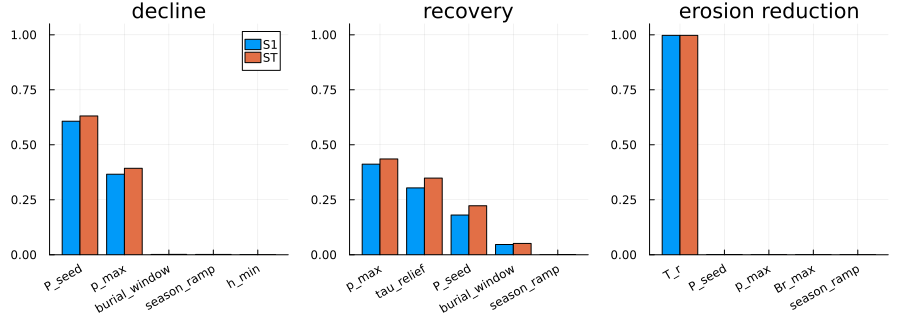
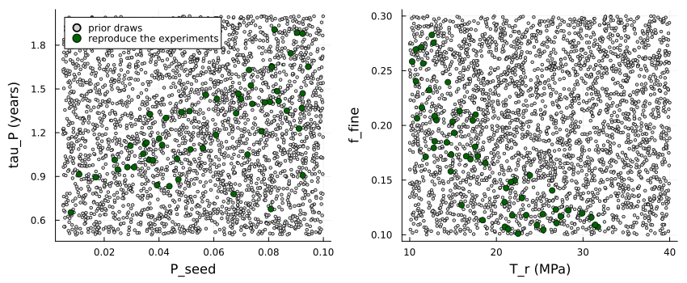

# Uncertainty in the marram grass model
Simon Frost

- [Overview](#overview)
- [Three predictions for one cell](#three-predictions-for-one-cell)
- [Which priors matter](#which-priors-matter)
- [History matching](#history-matching)
- [Predictions with ranges](#predictions-with-ranges)

## Overview

Every trait of the marram grass model has an evidence grade
(`marram_info`):

- **M** traits were measured on marram;
- **D** traits were fitted to experiments ([vignette
  13](13_marram_grass.md));
- **P** traits are priors, with no direct measurement.

This vignette asks how much the priors matter, in three steps: 1. a
Sobol analysis over the priors, which shows which unknowns drive which
predictions; 2. history matching, which keeps only the prior draws that
still reproduce the calibration experiments; 3. predictions, with
ranges, from the trait sets that remain: first for one cell, then for
the foredune and storm of [vignette
14](14_marram_foredune.md).

``` julia
ENV["GKSwstype"] = "100"
using Aeolis
using Dates
using Plots
using Printf
using QuasiMonteCarlo
using Random
using Statistics
const AE = Aeolis
```

## Three predictions for one cell

A stand at half its maximum density goes through three phases of sand
supply:

- years 0-4: 0.3 m of sand per growing season, about the optimum;
- years 4-7: none;
- year 7 onward: 0.3 m per season again.

Three predictions are read from this run:

- **decline:** the shoot density after three years without sand,
  relative to that at year 4;
- **recovery:** the shoot density a year after burial resumes, relative
  to that at year 4;
- **erosion reduction:** how much the roots of the year-4 stand reduce
  wave erosion of the dune, `c_r / (tau0 + c_r)`.

``` julia
function predictions(tr)
    z(t) = (4 * 365 <= t < 7 * 365) ? 0.0 : 0.3 / AE.season_length(tr)
    N0 = 0.5 * tr.N_max
    cell = MarramCell(; N=N0, h=0.5, Br=AE.root_target(N0, 0.3, tr), zr=0.5, s=tr.s_fc)
    sol = simulate_marram(cell, (t, d) -> (; dzb=z(t), s=tr.s_fc), tr; days=8 * 365,
                          start=Date(2020, 1, 1))
    i4, i7, i8 = 4 * 365 + 1, 7 * 365 + 1, 8 * 365 + 1
    return [sol.N[i7] / sol.N[i4], sol.N[i8] / sol.N[i4], sol.cr[i4] / (tr.tau0 + sol.cr[i4])]
end
labels = ["decline", "recovery", "erosion reduction"]
round.(predictions(MarramTraits()); digits=3)
```

    3-element Vector{Float64}:
     0.739
     0.832
     0.338

## Which priors matter

The Sobol indices of a prediction split its variance among the traits:

- the **first-order** index `S1` is the share that a trait causes alone;
- the **total** index `ST` adds its interactions with the other traits.

They are computed here with the estimators of Saltelli et al.
([2010](#ref-Saltelli2010)) (first order) and Jansen
([1999](#ref-Jansen1999)) (total). The design is one scrambled Sobol
sequence in twice as many dimensions as there are traits, split into the
two matrices the estimators need.

``` julia
function sobol_indices(f, lb, ub, n)
    k = length(lb)
    X = QuasiMonteCarlo.sample(n, vcat(lb, lb), vcat(ub, ub),
                               SobolSample(; R=OwenScramble(; base=2, pad=32)))
    A, B = X[1:k, :], X[(k + 1):end, :]
    fA = reduce(hcat, [f(A[:, j]) for j in 1:n])
    fB = reduce(hcat, [f(B[:, j]) for j in 1:n])
    V = vec(var(hcat(fA, fB); dims=2))
    S1 = zeros(size(fA, 1), k)
    ST = zeros(size(fA, 1), k)
    for i in 1:k
        ABi = copy(A)
        ABi[i, :] .= B[i, :]
        fABi = reduce(hcat, [f(ABi[:, j]) for j in 1:n])
        S1[:, i] .= vec(mean(fB .* (fABi .- fA); dims=2)) ./ V
        ST[:, i] .= vec(mean((fA .- fABi) .^ 2; dims=2)) ./ 2 ./ V
    end
    return (; S1, ST)
end
nothing
```

As a check, on the Ishigami function the indices are known exactly: `S1`
= 0.314, 0.442 and 0, and `ST` = 0.558, 0.442 and 0.244.

``` julia
Random.seed!(1)
ish(x) = [sin(x[1]) + 7 * sin(x[2])^2 + 0.1 * x[3]^4 * sin(x[1])]
check = sobol_indices(ish, fill(-float(pi), 3), fill(float(pi), 3), 4096)
println("S1 ", round.(check.S1[1, :]; digits=3), ", ST ", round.(check.ST[1, :]; digits=3))
```

    S1 [0.306, 0.443, -0.005], ST [0.557, 0.442, 0.244]

The analysis covers the priors that act in a single cell. Colonisation
and drag act only on a grid, and the ensemble below covers them.

``` julia
grid_only = (:f_jump, :jump_distance, :N_new, :h_new, :zr_new, :establishment, :kappa)
priors = filter(r -> !(r.name in grid_only), marram_ranges())
names = [r.name for r in priors]
base = MarramTraits()
Random.seed!(2)
sobol = sobol_indices(x -> predictions(MarramTraits(base, names, x)),
                      [r.low for r in priors], [r.high for r in priors], 2048)
plots = map(1:3) do k
    order = sortperm(sobol.ST[k, :]; rev=true)[1:5]
    pos = 1:5
    p = bar(pos .- 0.2, max.(sobol.S1[k, order], 0); bar_width=0.4, label="S1",
            title=labels[k], ylims=(0, 1.05), legend=k == 1)
    bar!(p, pos .+ 0.2, sobol.ST[k, order]; bar_width=0.4, label="ST",
         xticks=(pos, string.(names[order])), xrotation=30)
end
plot(plots...; layout=(1, 3), size=(900, 320), bottom_margin=8Plots.mm)
```



``` julia
for k in 1:3
    order = sortperm(sobol.ST[k, :]; rev=true)[1:3]
    @printf("%-18s %s\n", labels[k],
            join([@sprintf("%s %.2f", names[j], sobol.ST[k, j]) for j in order], ", "))
end
```

    decline            P_seed 0.63, p_max 0.39, burial_window 0.00
    recovery           p_max 0.44, tau_relief 0.35, P_seed 0.22
    erosion reduction  T_r 1.00, P_seed 0.00, p_max 0.00

Each prediction is driven by one or two unknowns:

- **decline** by the seed of the soil-biota build-up, `P_seed`, and the
  strength of the pressure, `p_max`;
- **recovery** by those two and by how fast fresh sand relieves
  pressure, `tau_relief`;
- **erosion reduction** almost entirely by the tensile strength of
  marram roots, `T_r`, which has never been measured.

These are the measurements that would most improve the model.

## History matching

Some D traits were fitted with the priors held at their defaults. For
example, the time scale of soil-biota pressure `tau_P` was fitted with
`P_seed` and `p_max` at theirs. Drawing the priors independently can
therefore give trait sets that no longer reproduce the experiments.

So the priors are drawn 3000 times, together with the three D traits
fitted with them: `tau_P`, `d_f` and the fine-root fraction `f_fine`. A
draw is kept only if it still reproduces three experiments:

- the shoots of the mesocosm of Reijers et
  al. ([2021](#ref-Reijers2021)), within 15 % in all three
  treatments;
- the burial response of Nolet et al.
  ([2018](#ref-Nolet2018)) below the optimum, with a root-mean-square
  difference below 0.05;
- the erosion reduction of a mature stand, between 26 and 41 %. That is
  the 31-36 % of marram in flume and core experiments ([Kosmalla et al.
  2026](#ref-Kosmalla2026); [De Battisti and Griffin
  2020](#ref-DeBattisti2020)), widened by 5 points.

``` julia
function plausible(tr)
    e = marram_experiment(:reijers2021, tr)
    all(abs.(e.shoots ./ e.shoots_observed .- 1) .< 0.15) || return false
    n = marram_experiment(:nolet2018, tr)
    below = n.burial .<= tr.burial_opt
    ndvi = vec(mean(n.ndvi_observed; dims=2))
    sqrt(mean(abs2, n.response[below] .- ndvi[below])) < 0.05 || return false
    return 0.26 <= marram_experiment(:root_erosion, tr).stand_reduction <= 0.41
end
draws = marram_sample(Xoshiro(7), 3000; add=(:tau_P, :d_f, :f_fine))
kept = filter(plausible, draws)
@printf("%d of %d draws reproduce the experiments\n", length(kept), length(draws))
```

    54 of 3000 draws reproduce the experiments

About 2 % of the draws survive, because the calibration data tie the
traits together. The kept draws show how:

``` julia
p1 = scatter([d.P_seed for d in draws], [d.tau_P for d in draws]; ms=2, color=:lightgray,
             label="prior draws", xlabel="P_seed", ylabel="tau_P (years)")
scatter!(p1, [d.P_seed for d in kept], [d.tau_P for d in kept]; ms=4, color=:darkgreen,
         label="reproduce the experiments")
p2 = scatter([d.T_r for d in draws], [d.f_fine for d in draws]; ms=2, color=:lightgray,
             legend=false, xlabel="T_r (MPa)", ylabel="f_fine")
scatter!(p2, [d.T_r for d in kept], [d.f_fine for d in kept]; ms=4, color=:darkgreen)
plot(p1, p2; layout=(1, 2), size=(850, 350), bottom_margin=5Plots.mm, left_margin=5Plots.mm)
```



``` julia
corr(a, b) = cor([getfield(d, a) for d in kept], [getfield(d, b) for d in kept])
@printf("correlation among kept draws: P_seed and tau_P %.2f, T_r and f_fine %.2f\n",
        corr(:P_seed, :tau_P), corr(:T_r, :f_fine))
```

    correlation among kept draws: P_seed and tau_P 0.66, T_r and f_fine -0.82

Two relationships stand out:

- **A larger seed of soil biota needs a slower build-up** (`tau_P`).
  This keeps the mesocosm, on fresh sand, from declining in its first
  year.
- **Stronger roots need fewer fine roots.** The erosion experiments fix
  only the product of tensile strength `T_r` and the fine-root fraction
  `f_fine`, not each one.

## Predictions with ranges

For one cell, the three predictions under the prior and under the kept
trait sets:

``` julia
q(v) = quantile(v, [0.05, 0.5, 0.95])
prior_pred = reduce(hcat, predictions.(draws[1:500]))
kept_pred = reduce(hcat, predictions.(kept))
for k in 1:3
    a, b = q(prior_pred[k, :]), q(kept_pred[k, :])
    @printf("%-18s prior %.2f (%.2f-%.2f); kept %.2f (%.2f-%.2f)\n", labels[k], a[2], a[1],
            a[3], b[2], b[1], b[3])
end
```

    decline            prior 0.73 (0.38-0.95); kept 0.70 (0.62-0.81)
    recovery           prior 0.74 (0.47-0.93); kept 0.70 (0.56-0.85)
    erosion reduction  prior 0.47 (0.28-0.65); kept 0.36 (0.30-0.41)

The numbers are medians with 5-95 % ranges. The experiments narrow all
three predictions:

- **decline and recovery,** through the soil-biota traits;
- **the erosion reduction,** through the product of root strength and
  fine-root fraction.

For the foredune, 32 of the kept trait sets are run through two years of
the [vignette 14](14_marram_foredune.md) beach and
then its storm, as an `EnsembleProblem`. Each member reads its traits
from its own file (`write_marram_traits`).

``` julia
day = 86400.0
years = 2
rng = Xoshiro(1)
x = collect(0.0:1.0:150.0)
zb0 = @. min(-1.0 + x / 25, 3.0)
nd = 365 * years + 1
td = (0:(nd - 1)) .* day
wind = hcat(td, [7.0 / 0.886 * sqrt(-log(rand(rng))) for _ in td],
            [270.0 + 80 * (rand(rng) - 0.5) for _ in td])
tt = collect(0.0:3600.0:(nd * day))
tide = hcat(tt, sin.(2pi .* tt ./ (12.42 * 3600)))
doy = [(k % 365) + 1 for k in 0:(nd - 1)]
water = hcat(td, [rand(rng) < 0.45 ? -4.9 * log(rand(rng)) : 0.0 for _ in td],
             @. 2.0 - 1.5 * cos(2pi * (doy - 15) / 365))
base_run = (; xgrid_file=x, bed_file=zb0, ne_file=(@. ifelse(x >= 126, zb0, -10.0)),
            th_nelayer=true, wind_file=wind, tide_file=tide, process_tide=true,
            grain_size=0.0003, dt=3600.0, tstop=years * 365day, output_times=365day,
            refdate="2020-01-01 00:00", process_avalanche=true, output_vars=[:zb],
            process_vegetation=true, veg_model=:marram,
            veg_file=(@. ifelse(110 <= x <= 125, 0.3, 0.0)), veg_water_file=water)
dir = mktempdir()
members = 32
files = [write_marram_traits(joinpath(dir, "member$i.toml"), kept[i]) for i in 1:members]
inert = [write_marram_traits(joinpath(dir, "inert$i.toml"), MarramTraits(kept[i]; tau0=1e12))
         for i in 1:members]
grow = EnsembleProblem(AeolisProblem(AeolisParameters(; base_run...));
                       prob_func=(pr, ctx) -> remake(pr; veg_traits_file=files[ctx.sim_id]))
grown = solve(grow, EulerBackward(), AE.SciMLBase.EnsembleThreads(); trajectories=members)
t0 = years * 365day
storm = (; tstart=t0, tstop=t0 + 2day, output_times=2day,
         wind_file=[0.0 2.0 270.0; 4000day 2.0 270.0], tide_file=[0.0 2.5; 4000day 2.5],
         wave_file=[0.0 3.0 10.0; 4000day 3.0 10.0], process_wave=true, process_runup=true,
         process_dune_erosion=true, dune_toe_elevation=2.7, beach_slope=0.04)
storm_prob = AeolisProblem(AeolisParameters(; base_run..., storm...))
function eroded(traitfiles)
    ep = EnsembleProblem(storm_prob;
                         prob_func=(pr, ctx) -> remake(pr; u0=grown.u[ctx.sim_id].u,
                                                       veg_traits_file=traitfiles[ctx.sim_id]))
    es = solve(ep, EulerBackward(), AE.SciMLBase.EnsembleThreads(); trajectories=members)
    return [sum(max.(grown.u[i].u.zb[:, 2] .- es.u[i].u.zb[:, 2], 0.0)) for i in 1:members]
end
with_roots = eroded(files)
without_roots = eroded(inert)
volume = [sum(max.(s.u.zb[101:end, 2] .- 3.0, 0.0)) for s in grown.u]
for (lab, v) in (("dune volume after 2 years (m³/m)", volume),
                 ("storm erosion with roots (m³/m)", with_roots),
                 ("storm erosion without roots (m³/m)", without_roots),
                 ("reduction by roots", 1 .- with_roots ./ without_roots))
    a = q(v)
    @printf("%-36s %.2f (%.2f-%.2f)\n", lab, a[2], a[1], a[3])
end
```

    dune volume after 2 years (m³/m)     37.80 (34.82-42.06)
    storm erosion with roots (m³/m)      27.16 (24.08-30.39)
    storm erosion without roots (m³/m)   35.66 (32.84-39.96)
    reduction by roots                   0.25 (0.14-0.32)

These ranges are the uncertainty left by the priors once the calibration
experiments are respected. They do not include:

- uncertainty in the M and D traits themselves;
- uncertainty in the forcing, a single synthetic weather series here;
- uncertainty in AeoLiS’s own transport and erosion parameters.

The analysis also points to the measurements that would narrow the
ranges most:

- how fast soil biota build up and how strongly they act (`P_seed`,
  `p_max`);
- how fast fresh sand relieves them (`tau_relief`);
- the tensile strength and fine-root fraction of marram roots, which the
  erosion data cannot separate.

```@raw html
<div id="refs" class="references csl-bib-body hanging-indent">
```

```@raw html
<div id="ref-DeBattisti2020" class="csl-entry">
```

De Battisti, Davide, and John N. Griffin. 2020. “Below-Ground Biomass of
Plants, with a Key Contribution of Buried Shoots, Increases Foredune
Resistance to Wave Swash.” *Annals of Botany* 125: 325–34.
<https://doi.org/10.1093/aob/mcz125>.

```@raw html
</div>
```

```@raw html
<div id="ref-Jansen1999" class="csl-entry">
```

Jansen, Michiel J. W. 1999. “Analysis of Variance Designs for Model
Output.” *Computer Physics Communications* 117: 35–43.
<https://doi.org/10.1016/S0010-4655(98)00154-4>.

```@raw html
</div>
```

```@raw html
<div id="ref-Kosmalla2026" class="csl-entry">
```

Kosmalla, Viktoria, Oliver Lojek, Lukas Ahrenbeck, et al. 2026.
“Vegetation Effects on Dune Erosion Under Wave Collision: Influence of
Planting Density, Biomass Distribution and Arrangement in Scaled
Experiments.” *Coastal Engineering* 204: 104899.
<https://doi.org/10.1016/j.coastaleng.2025.104899>.

```@raw html
</div>
```

```@raw html
<div id="ref-Nolet2018" class="csl-entry">
```

Nolet, Corjan, Marinka van Puijenbroek, Juha
Suomalainen, Juul Limpens, and Michel Riksen. 2018. “UAV-Imaging
to Model Growth Response of Marram Grass to Sand Burial: Implications
for Coastal Dune Development.” *Aeolian Research* 31: 50–61.
<https://doi.org/10.1016/j.aeolia.2017.08.006>.

```@raw html
</div>
```

```@raw html
<div id="ref-Reijers2021" class="csl-entry">
```

Reijers, Valérie C., Selwyn Hoeks, Jim van Belzen,
et al. 2021. “Sediment Availability Provokes a Shift from
Brownian to
L<span class="nocase">évy</span>-Like Clonal
Expansion in a Dune Building Grass.” *Ecology Letters* 24: 258–68.
<https://doi.org/10.1111/ele.13638>.

```@raw html
</div>
```

```@raw html
<div id="ref-Saltelli2010" class="csl-entry">
```

Saltelli, Andrea, Paola Annoni, Ivano Azzini, Francesca Campolongo,
Marco Ratto, and Stefano Tarantola. 2010. “Variance Based Sensitivity
Analysis of Model Output. Design and Estimator for the Total Sensitivity
Index.” *Computer Physics Communications* 181: 259–70.
<https://doi.org/10.1016/j.cpc.2009.09.018>.

```@raw html
</div>
```

```@raw html
</div>
```
