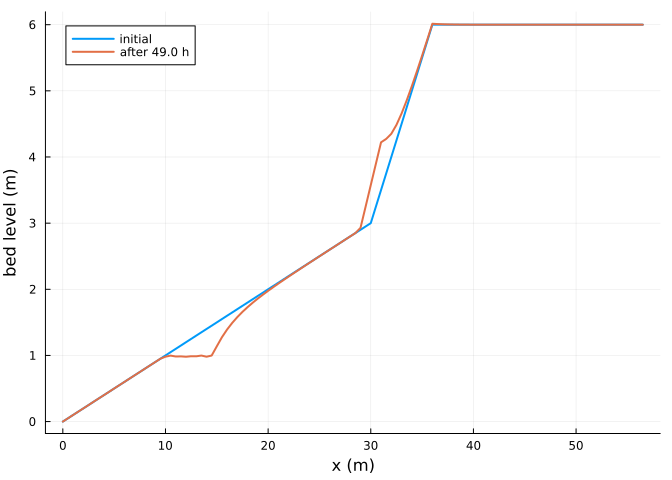

# AeoLiS configuration files
Simon Frost

- [Overview](#overview)
- [Reading a configuration file](#reading-a-configuration-file)
- [Running it](#running-it)
- [Agreement with aeolis-python](#agreement-with-aeolis-python)
- [Writing configuration files](#writing-configuration-files)
- [References](#references)

## Overview

AeoLiS models are usually described by a configuration file,
`aeolis.txt`, with one `key = value` line per parameter and input data
in separate text files. Aeolis.jl reads these files, runs them as
`aeolis run` does, and writes netCDF output in the AeoLiS layout. This
vignette runs one of the AeoLiS regression cases, a transect with tides,
waves, runup, vegetation and avalanching, and compares the result with
aeolis-python ([<span class="nocase">de Vries et al.</span>
2023](#ref-deVries2023)).

``` julia
ENV["GKSwstype"] = "100"
using Aeolis
using NCDatasets
using Plots
```

## Reading a configuration file

The case ships with the package tests. Its configuration file names the
grid, bed, wind, tide and wave files, which `read_config` loads relative
to the file’s directory. Keys that AeoLiS itself ignores (this file has
six, such as `process_nelayer`) are skipped with a warning, which is
hidden here.

``` julia
case = joinpath(pkgdir(Aeolis), "test", "data", "case1_small_waves")
readdir(case)
```

    9-element Vector{String}:
     "aeolis.txt"
     "reference.nc"
     "tide.txt"
     "veg.grd"
     "wave.txt"
     "wind.txt"
     "x.grd"
     "y.grd"
     "z.grd"

``` julia
p = read_config(joinpath(case, "aeolis.txt"))
```

    AeolisParameters
      time: 0.0 to 172800.0 s, dt = 3600.0 s
      scheme: euler_backward, solver: trunk
      fractions: 1, layers: 3
      enabled: process_wind, process_transport, process_bedupdate, process_threshold, th_grainsize, process_avalanche, process_tide, process_wave, process_runup, process_vegetation

Spatial files hold one row per grid row, as in AeoLiS; they are stored
with x as the first dimension. Time series keep their columns:

``` julia
size(p.xgrid_file), size(p.wind_file), p.wind_file[1:3, :]
```

    ((114,), (49, 3), [0.0 15.0 0.0; 3600.0 15.0 0.0; 7200.0 15.0 0.0])

## Running it

`run_config` solves the problem with the scheme and solver of the file
and, because NCDatasets is loaded, writes the output file:

``` julia
out = joinpath(mktempdir(), "aeolis.nc")
sol = run_config(joinpath(case, "aeolis.txt"); outputfile=out)
```

    AeolisSolution with 50 output times from 0.0 to 176400.0 s, retcode Success
      saved: Ct, Hs, mass, qs, w, zb, zs

The netCDF file has the AeoLiS dimensions `s`, `n`, `time`, `layers` and
`fractions`, with a transect written as a single row:

``` julia
NCDataset(out) do ds
    [(k, size(ds[k])) for k in keys(ds) if k in ("x", "zb", "mass", "Ct", "time")]
end
```

    5-element Vector{Tuple{String, Tuple{Int64, Vararg{Int64}}}}:
     ("x", (114, 1))
     ("time", (50,))
     ("zb", (114, 1, 50))
     ("Ct", (1, 114, 1, 50))
     ("mass", (1, 3, 114, 1, 50))

``` julia
zb = transect(sol, :zb)
plot(sol.u.x[:, 2], zb[:, 1]; lw=2, label="initial", xlabel="x (m)", ylabel="bed level (m)")
plot!(sol.u.x[:, 2], zb[:, end]; lw=2, label="after $(sol.t[end] / 3600) h")
```



## Agreement with aeolis-python

The test data also hold `reference.nc`: the full model state of
aeolis-python after every time step of the same case, in double
precision. Stepping the Julia model alongside it compares every step:

``` julia
ref = NCDataset(joinpath(case, "reference.nc"))
pyzb = Array(ref["zb"])           # (x, y, step): netCDF's (step, y, x) reversed
integ = init(AeolisProblem(p); save_vars=Symbol[])
diffs = Float64[]
for k in 1:(size(pyzb, 3) - 1)
    step!(integ)
    push!(diffs, maximum(abs.(integ[:zb] .- pyzb[:, :, k + 1])))
end
close(ref)
diffs
```

    6-element Vector{Float64}:
     4.440892098500626e-16
     4.440892098500626e-16
     4.440892098500626e-16
     4.440892098500626e-16
     4.440892098500626e-16
     4.440892098500626e-16

The largest difference in bed level over these steps is at the level of
round-off:

``` julia
maximum(diffs)
```

    4.440892098500626e-16

## Writing configuration files

`write_config` writes parameters back to a configuration file, with
input arrays in text files next to it, so a model built in Julia can be
run by aeolis-python:

``` julia
dir = mktempdir()
write_config(joinpath(dir, "aeolis.txt"), p)
filter(f -> endswith(f, ".txt"), readdir(dir))
```

    8-element Vector{String}:
     "aeolis.txt"
     "bed.txt"
     "tide.txt"
     "veg.txt"
     "wave.txt"
     "wind.txt"
     "xgrid.txt"
     "ygrid.txt"

``` julia
q = read_config(joinpath(dir, "aeolis.txt"))
q.xgrid_file ≈ p.xgrid_file && q.wind_file ≈ p.wind_file && q.grain_size == p.grain_size
```

    true

## References

<div id="refs" class="references csl-bib-body hanging-indent">

<div id="ref-deVries2023" class="csl-entry">

<span class="nocase">de Vries, Sierd, Caroline Hallin, Christa van
IJzendoorn, et al.</span> 2023. *AeoLiS*. Computer software, version
3.0.1. <https://github.com/openearth/aeolis-python>.

</div>

</div>
