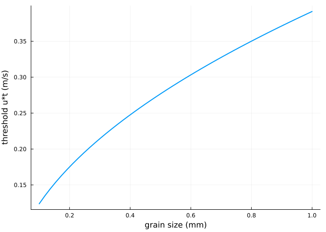
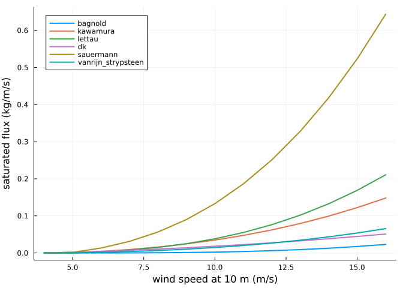

# Transport formulations
Simon Frost

- [Overview](#overview)
- [Shear velocity and its threshold](#shear-velocity-and-its-threshold)
- [Saturated flux](#saturated-flux)
- [Grain velocity](#grain-velocity)
- [References](#references)

## Overview

The saturated sediment flux is a function of the shear velocity `u*` and
its threshold `u*t`. AeoLiS offers several classic formulations of it,
of which Bagnold’s is the default ([Bagnold 1937](#ref-Bagnold1937);
[<span class="nocase">van Rijn and Strypsteen</span>
2020](#ref-vanRijn2020)), and several ways to compute the grain
velocity, including the grain-scale model of Durán et al.
([2011](#ref-Duran2011)). This vignette compares them by running the
model on a long flat transect, where the flux downwind is saturated.

``` julia
ENV["GKSwstype"] = "100"
using Aeolis
using Plots
```

## Shear velocity and its threshold

The wind at height `z` gives the shear velocity through the law of the
wall with roughness length `z0` (by default `z0 = k`, as in AeoLiS for
backward compatibility). The threshold from grain size is Bagnold’s
`Aa sqrt((rhog - rhoa) / rhoa g d)`:

``` julia
p = AeolisParameters()
ustar(u) = u * p.kappa / log(p.z / p.k)
uth(d) = p.Aa * sqrt((p.rhog - p.rhoa) / p.rhoa * p.g * d)
d = range(0.1e-3, 1.0e-3; length=50)
plot(1000 .* d, uth.(d); lw=2, xlabel="grain size (mm)", ylabel="threshold u*t (m/s)",
     label="")
```



A grain of 0.3 mm starts to move at a wind speed (at 10 m) of

``` julia
uth(0.3e-3) / p.kappa * log(p.z / p.k)
```

    4.816819474863292

## Saturated flux

A helper runs a 100 m flat transect for half an hour and returns the
flux at its downwind end:

``` julia
function saturated_flux(u; kwargs...)
    x = collect(0.0:1.0:100.0)
    q = AeolisParameters(; xgrid_file=x, bed_file=fill(2.0, length(x)),
                         wind_file=[0.0 u 270.0; 86400.0 u 270.0], grain_size=0.0003,
                         dt=300.0, tstop=1800.0, output_times=1800.0, output_vars=[:qs],
                         kwargs...)
    sol = solve(AeolisProblem(q))
    return transect(sol, :qs)[end - 1, 1, end]
end
saturated_flux(10.0)
```

    0.002300579301885339

``` julia
speeds = 4.0:1.0:16.0
plt = plot(; xlabel="wind speed at 10 m (m/s)", ylabel="saturated flux (kg/m/s)",
           legend=:topleft)
for m in (:bagnold, :kawamura, :lettau, :dk, :sauermann, :vanrijn_strypsteen)
    plot!(plt, speeds, [saturated_flux(u; method_transport=m) for u in speeds];
          lw=2, label=String(m))
end
plt
```



The formulations agree on a threshold and a steep rise above it; they
differ by factors of two or more at high wind speed, which is why the
transport constant (`Cb`, `Ck`, `Cl`, `Cdk`) is often calibrated.

## Grain velocity

The flux is the concentration times the grain velocity. With
`method_grainspeed = :windspeed` grains move at the wind speed; `:duran`
uses the grain-scale model of Duran et al., including the effect of bed
slopes; `:constant` sets 1 m/s. Since the saturated concentration is the
saturated flux divided by the grain velocity, the flux of the Bagnold
formulation is the same for every grain velocity, but the concentration
and the adaptation length are not:

``` julia
function saturated_state(u, method)
    x = collect(0.0:1.0:100.0)
    q = AeolisParameters(; xgrid_file=x, bed_file=fill(2.0, length(x)),
                         wind_file=[0.0 u 270.0; 86400.0 u 270.0], grain_size=0.0003,
                         dt=300.0, tstop=1800.0, output_times=1800.0,
                         output_vars=[:qs, :Ct, :u], method_grainspeed=method)
    sol = solve(AeolisProblem(q))
    return (; method, flux=transect(sol, :qs)[end - 1, 1, end],
            concentration=transect(sol, :Ct)[end - 1, 1, end],
            grain_velocity=transect(sol, :u)[end - 1, 1, end])
end
[saturated_state(12.0, m) for m in (:windspeed, :duran, :constant)]
```

    3-element Vector{@NamedTuple{method::Symbol, flux::Float64, concentration::Float64, grain_velocity::Float64}}:
     (method = :windspeed, flux = 0.0061217561693647045, concentration = 0.0005101463474470587, grain_velocity = 12.0)
     (method = :duran, flux = 0.006123972245587834, concentration = 0.004424653136204793, grain_velocity = 1.3840570225671107)
     (method = :constant, flux = 0.006123972245587831, concentration = 0.006123972245587831, grain_velocity = 1.0)

## References

<div id="refs" class="references csl-bib-body hanging-indent">

<div id="ref-Bagnold1937" class="csl-entry">

Bagnold, R. A. 1937. “The Transport of Sand by Wind.” *The Geographical
Journal* 89: 409–38. <https://doi.org/10.2307/1786411>.

</div>

<div id="ref-Duran2011" class="csl-entry">

Durán, O., P. Claudin, and B. Andreotti. 2011. “On Aeolian Transport:
Grain-Scale Interactions, Dynamical Mechanisms and Scaling Laws.”
*Aeolian Research* 3: 243–70.
<https://doi.org/10.1016/j.aeolia.2011.07.006>.

</div>

<div id="ref-vanRijn2020" class="csl-entry">

<span class="nocase">van Rijn, L. C., and G. Strypsteen</span>. 2020. “A
Fully Predictive Model for Aeolian Sand Transport.” *Coastal
Engineering* 156: 103600.
<https://doi.org/10.1016/j.coastaleng.2019.103600>.

</div>

</div>
