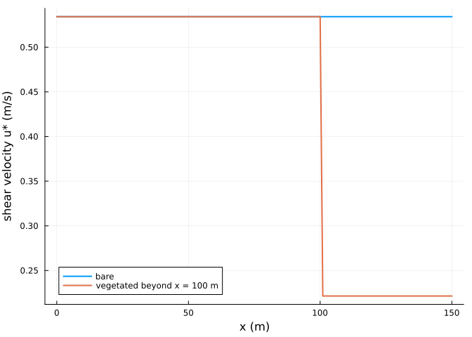
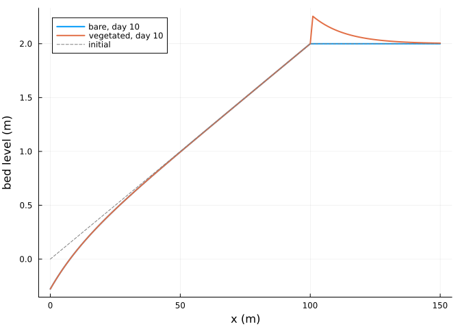
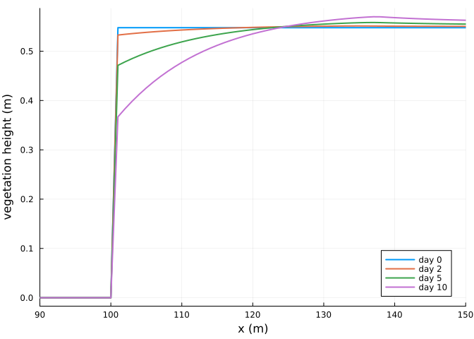
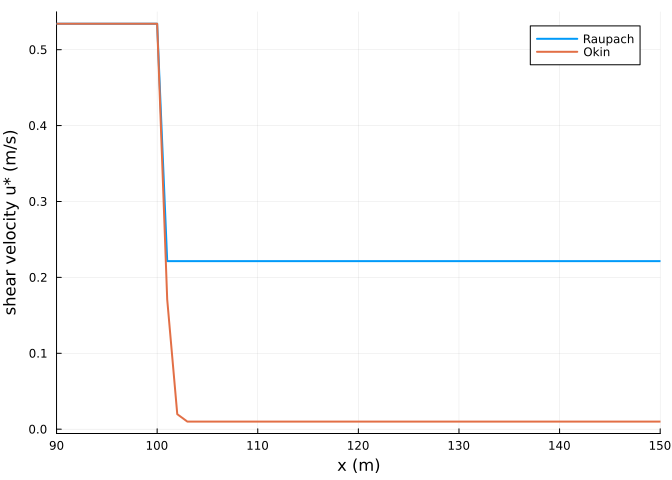

# Vegetation and foredunes
Simon Frost

- [Overview](#overview)
- [A vegetated backbeach](#a-vegetated-backbeach)
- [Shear reduction](#shear-reduction)
- [Trapping](#trapping)
- [Plant response](#plant-response)
- [Okin’s shear reduction](#okins-shear-reduction)
- [References](#references)

## Overview

Dune plants reduce the shear velocity at the bed, so sand blown off the
beach is trapped among them. AeoLiS reduces the shear velocity by
Raupach’s factor `1 / sqrt(1 + gamma rho)` of the vegetation cover `rho`
([Raupach 1992](#ref-Raupach1992); [Raupach et al.
1993](#ref-Raupach1993)), or by Okin’s reduction in the lee of each
plant ([Okin 2008](#ref-Okin2008)). Plants grow towards a maximum height
and respond to burial, either with the original AeoLiS rule or that of
Durán and Moore ([2013](#ref-Duran2013)). This vignette grows a foredune
behind a dry beach.

``` julia
ENV["GKSwstype"] = "100"
using Aeolis
using Plots
```

## A vegetated backbeach

``` julia
x = collect(0.0:1.0:150.0)
zb = @. min(0.02 * x, 2.0)
veg = @. ifelse(x > 100, 0.3, 0.0)
day = 86400.0
base = (; xgrid_file=x, bed_file=zb, wind_file=[0.0 12.0 270.0; 365day 12.0 270.0],
        grain_size=0.0003, dt=3600.0, tstop=10day, output_times=day,
        output_vars=[:zb, :rhoveg, :hveg, :ustar, :qs], process_avalanche=true)
bare = solve(AeolisProblem(AeolisParameters(; base...)))
plants = solve(AeolisProblem(AeolisParameters(; base..., process_vegetation=true,
                                              veg_file=veg, gamma_vegshear=16.0,
                                              hveg_max=1.0, V_ver=2.0, dzb_opt=0.5,
                                              avg_time=day)))
```

    AeolisSolution with 11 output times from 0.0 to 864000.0 s, retcode Success
      saved: hveg, qs, rhoveg, ustar, zb

## Shear reduction

``` julia
plot(x, transect(bare, :ustar)[:, 2]; lw=2, label="bare", xlabel="x (m)",
     ylabel="shear velocity u* (m/s)")
plot!(x, transect(plants, :ustar)[:, 2]; lw=2, label="vegetated beyond x = 100 m")
```



With a cover of 0.3 and `gamma = 16`, the shear velocity falls by a
factor `1 / sqrt(1 + 16 * 0.3)`:

``` julia
1 / sqrt(1 + 16 * 0.3)
```

    0.41522739926869984

## Trapping

Sand arriving at the vegetation is deposited where the shear velocity
drops below the threshold, building a foredune at its seaward edge:

``` julia
plot(x, transect(bare, :zb)[:, end]; lw=2, label="bare, day 10", xlabel="x (m)",
     ylabel="bed level (m)")
plot!(x, transect(plants, :zb)[:, end]; lw=2, label="vegetated, day 10")
plot!(x, zb; lw=1, ls=:dash, color=:gray, label="initial")
```



``` julia
dz = transect(plants, :zb)[:, end] .- zb
(max_accretion=round(maximum(dz); digits=3), at_x=x[argmax(dz)])
```

    (max_accretion = 0.255, at_x = 101.0)

## Plant response

The vegetation height changes with the growth potential `V_ver`, less
the effect of burial away from the optimum `dzb_opt`; the cover follows
the height:

``` julia
plot(x, transect(plants, :hveg)[:, [1, 3, 6, 11]]; lw=2, xlabel="x (m)",
     ylabel="vegetation height (m)", label=["day 0" "day 2" "day 5" "day 10"],
     xlims=(90, 150))
```



## Okin’s shear reduction

The Okin model reduces the shear velocity downwind of each plant, with a
reduction that recovers over some twenty plant heights. Under continuous
cover the reductions of the plants upwind add up, so the shear velocity
falls to the model’s floor of 0.01 m/s within a few metres of the edge
of the vegetation, where Raupach’s factor gives a uniform reduction:

``` julia
okin = solve(AeolisProblem(AeolisParameters(; base..., process_vegetation=true,
                                            veg_file=veg, vegshear_type=:okin, tstop=day)))
plot(x, transect(plants, :ustar)[:, 2]; lw=2, label="Raupach", xlabel="x (m)",
     ylabel="shear velocity u* (m/s)", xlims=(90, 150))
plot!(x, transect(okin, :ustar)[:, 2]; lw=2, label="Okin")
```



## References

<div id="refs" class="references csl-bib-body hanging-indent">

<div id="ref-Duran2013" class="csl-entry">

Durán, Orencio, and Laura J. Moore. 2013. “Vegetation Controls on the
Maximum Size of Coastal Dunes.” *Proceedings of the National Academy of
Sciences* 110: 17217–22. <https://doi.org/10.1073/pnas.1307580110>.

</div>

<div id="ref-Okin2008" class="csl-entry">

Okin, Gregory S. 2008. “A New Model of Wind Erosion in the Presence of
Vegetation.” *Journal of Geophysical Research: Earth Surface* 113:
F02S10. <https://doi.org/10.1029/2007JF000758>.

</div>

<div id="ref-Raupach1992" class="csl-entry">

Raupach, M. R. 1992. “Drag and Drag Partition on Rough Surfaces.”
*Boundary-Layer Meteorology* 60: 375–95.
<https://doi.org/10.1007/BF00155203>.

</div>

<div id="ref-Raupach1993" class="csl-entry">

Raupach, M. R., D. A. Gillette, and J. F. Leys. 1993. “The Effect of
Roughness Elements on Wind Erosion Threshold.” *Journal of Geophysical
Research: Atmospheres* 98: 3023–29. <https://doi.org/10.1029/92JD01922>.

</div>

</div>
