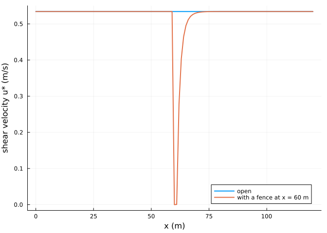
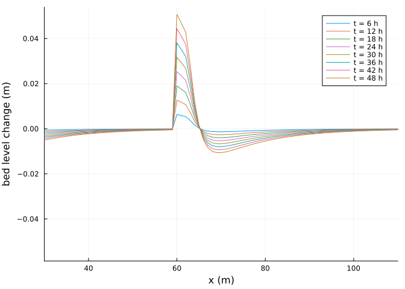
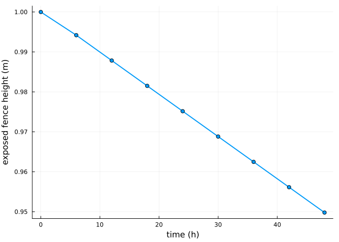

# Sand fences
Simon Frost

- [Overview](#overview)
- [Sheltering](#sheltering)
- [Deposition and burial](#deposition-and-burial)
- [References](#references)

## Overview

Sand fences are a common way to build dunes. In AeoLiS a fence reduces
the shear velocity in its lee following Okin’s model of porous roughness
elements ([Okin 2008](#ref-Okin2008)), computed on a grid aligned with
the wind, and is buried as sand accumulates around it; a fence lower
than 0.1 m no longer acts. This vignette places a fence on a beach and
compares the deposition with an open beach.

``` julia
ENV["GKSwstype"] = "100"
using Aeolis
using Plots
```

``` julia
x = collect(0.0:1.0:120.0)
zb = fill(2.0, length(x))
fence = zeros(length(x))
fence[61] = 1.0                   # a 1 m fence at x = 60 m
base = (; xgrid_file=x, bed_file=zb, wind_file=[0.0 12.0 270.0; 30 * 86400.0 12.0 270.0],
        grain_size=0.0003, dt=1800.0, tstop=2 * 86400.0, output_times=6 * 3600.0,
        output_vars=[:zb, :ustar, :fence_height, :qs], dx=1.0)
open_beach = solve(AeolisProblem(AeolisParameters(; base...)))
fenced = solve(AeolisProblem(AeolisParameters(; base..., process_fences=true,
                                              fence_file=fence)))
```

    AeolisSolution with 9 output times from 0.0 to 172800.0 s, retcode Success
      saved: fence_height, qs, ustar, zb

## Sheltering

``` julia
plot(x, transect(open_beach, :ustar)[:, 2]; lw=2, label="open", xlabel="x (m)",
     ylabel="shear velocity u* (m/s)")
plot!(x, transect(fenced, :ustar)[:, 2]; lw=2, label="with a fence at x = 60 m")
```



The shear velocity drops behind the fence and recovers over some ten
fence heights.

## Deposition and burial

``` julia
dz = transect(fenced, :zb) .- zb
plot(x, dz[:, 2:end]; xlabel="x (m)", ylabel="bed level change (m)",
     label=permutedims(["t = $(Int(t / 3600)) h" for t in fenced.t[2:end]]), xlims=(30, 110))
```



``` julia
plot(fenced.t ./ 3600, transect(fenced, :fence_height)[61, :]; lw=2, marker=:circle,
     xlabel="time (h)", ylabel="exposed fence height (m)", label="")
```



The deposit holds sand that the wind brought to the fence:

``` julia
rhob = 2650.0 * (1 - 0.4)
trapped = sum(max.(dz[45:80, end], 0.0)) * rhob       # kg per metre of fence, 1 m cells
round(trapped; digits=1)
```

    290.1

On this beach the bed downwind of the fence is as loose as the bed
upwind, so the wind picks up a new load past the fence and the flux
leaving the transect barely changes:

``` julia
out(sol) = sum(transect(sol, :qs)[end - 1, 1, 2:end]) * 6 * 3600.0
(open=round(out(open_beach); digits=1), fenced=round(out(fenced); digits=1))
```

    (open = 1058.1, fenced = 1053.6)

A fence protects what lies behind it only where the supply there is
limited, for example a vegetated or armoured backbeach.

## References

<div id="refs" class="references csl-bib-body hanging-indent">

<div id="ref-Okin2008" class="csl-entry">

Okin, Gregory S. 2008. “A New Model of Wind Erosion in the Presence of
Vegetation.” *Journal of Geophysical Research: Earth Surface* 113:
F02S10. <https://doi.org/10.1029/2007JF000758>.

</div>

</div>
