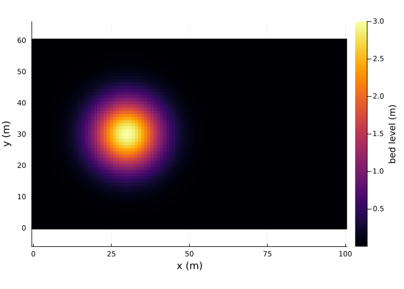
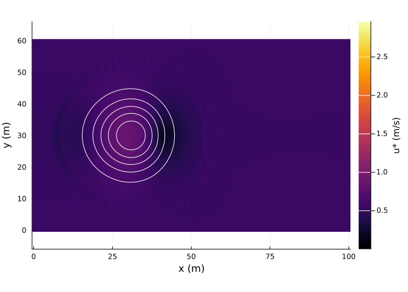
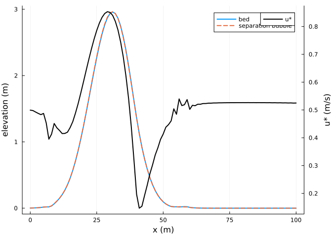
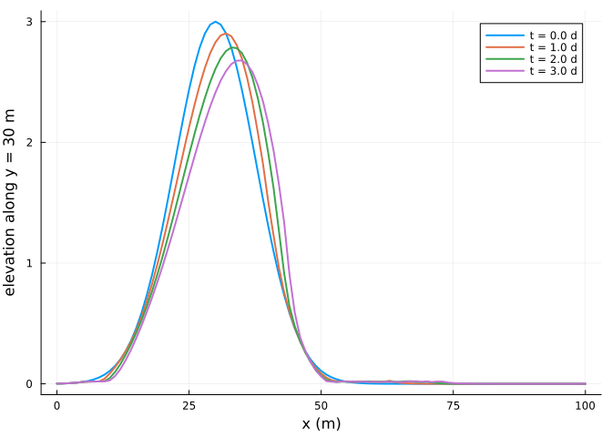

# Dunes in two dimensions
Simon Frost

- [Overview](#overview)
- [A sand hill](#a-sand-hill)
- [Shear over the hill](#shear-over-the-hill)
- [Migration](#migration)
- [References](#references)

## Overview

Over a dune the wind accelerates up the stoss slope and slows down in
the lee. AeoLiS computes this perturbation of the shear stress with the
spectral method of Weng et al. ([1991](#ref-Weng1991)) on a
computational grid aligned with the wind, after smoothing steep lee
slopes with a separation bubble, under which the shear stress vanishes
([Kroy et al. 2002](#ref-Kroy2002)). This vignette runs a small dune on
a non-erodible floor, a setting that makes it migrate as a barchan.

``` julia
ENV["GKSwstype"] = "100"
using Aeolis
using Plots
```

## A sand hill

``` julia
xs = 0.0:1.0:100.0
ys = 0.0:1.0:60.0
X = [x for x in xs, y in ys]
Y = [y for x in xs, y in ys]
Z = @. 3.0 * exp(-((X - 30)^2 + (Y - 30)^2) / 120)
heatmap(xs, ys, permutedims(Z); aspect_ratio=:equal, xlabel="x (m)", ylabel="y (m)",
        colorbar_title="bed level (m)")
```



The hill sits on a non-erodible floor at 0.01 m, and the wind blows
along x at 12 m/s.

``` julia
day = 86400.0
p = AeolisParameters(; xgrid_file=X, ygrid_file=Y, bed_file=Z, ne_file=fill(0.01, size(Z)),
                     th_nelayer=true, wind_file=[0.0 12.0 270.0; 365day 12.0 270.0],
                     process_shear=true, process_separation=true, process_avalanche=true,
                     solver=:pieter, boundary_offshore=:constant, boundary_onshore=:constant,
                     boundary_lateral=:circular, nlayers=1, layer_thickness=0.05,
                     grain_size=0.00025, method_grainspeed=:duran, L=50.0, l=1.0,
                     buffer_width=10.0, dt=3600.0, tstop=3day, output_times=day / 2,
                     output_vars=[:zb, :ustar, :zsep, :hsep, :qs])
sol = solve(AeolisProblem(p))
```

    AeolisSolution with 7 output times from 0.0 to 259200.0 s, retcode Success
      saved: hsep, qs, ustar, zb, zsep

## Shear over the hill

The shear velocity rises over the crest and is zero under the separation
bubble in the lee:

``` julia
heatmap(xs, ys, permutedims(sol[:ustar][:, :, 2]); aspect_ratio=:equal, xlabel="x (m)",
        ylabel="y (m)", colorbar_title="u* (m/s)")
contour!(xs, ys, permutedims(sol[:zb][:, :, 2]); levels=0.5:0.5:3, color=:white)
```



``` julia
j = 31
plot(xs, sol[:zb][:, j, 2]; lw=2, label="bed", xlabel="x (m)", ylabel="elevation (m)")
plot!(xs, sol[:zsep][:, j, 2]; lw=2, ls=:dash, label="separation bubble")
plot!(twinx(), xs, sol[:ustar][:, j, 2]; lw=2, color=:black, label="u*", ylabel="u* (m/s)",
      legend=:topright)
```



## Migration

The hill loses sand on its stoss side and gains it in the lee, so its
crest moves downwind:

``` julia
plot(xs, sol[:zb][:, j, 1:2:end]; lw=2, xlabel="x (m)", ylabel="elevation along y = 30 m",
     label=permutedims(["t = $(t / day) d" for t in sol.t[1:2:end]]))
```



``` julia
crest = [xs[argmax(sol[:zb][:, j, k])] for k in eachindex(sol.t)]
(times_days=sol.t ./ day, crest_x=crest)
```

    (times_days = [0.0, 0.5, 1.0, 1.5, 2.0, 2.5, 3.0], crest_x = [30.0, 31.0, 32.0, 33.0, 33.0, 34.0, 35.0])

## References

<div id="refs" class="references csl-bib-body hanging-indent">

<div id="ref-Kroy2002" class="csl-entry">

Kroy, Klaus, Gerd Sauermann, and Hans J. Herrmann. 2002. “Minimal Model
for Aeolian Sand Dunes.” *Physical Review E* 66: 031302.
<https://doi.org/10.1103/PhysRevE.66.031302>.

</div>

<div id="ref-Weng1991" class="csl-entry">

Weng, W. S., J. C. R. Hunt, D. J. Carruthers, et al. 1991. “Air Flow and
Sand Transport over Sand-Dunes.” In *Aeolian Grain Transport*. Acta
Mechanica Supplementum. <https://doi.org/10.1007/978-3-7091-6703-8_1>.

</div>

</div>
