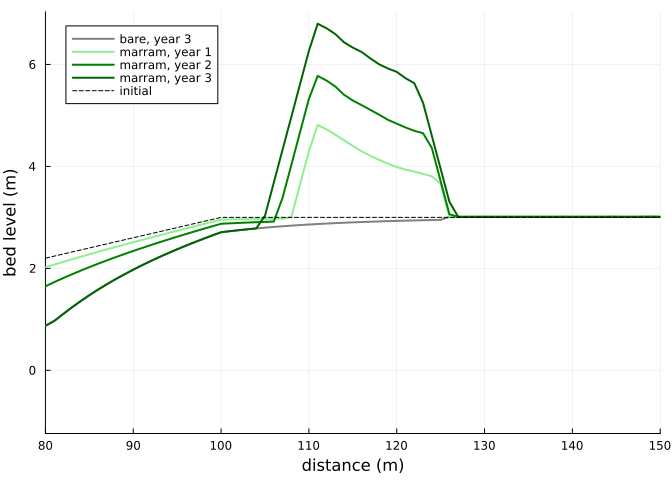
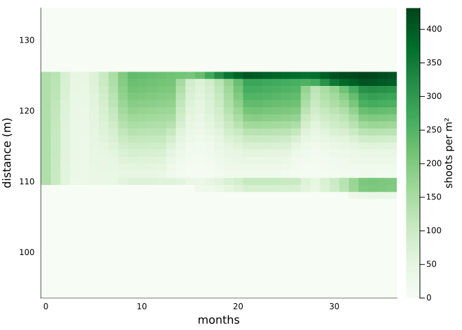
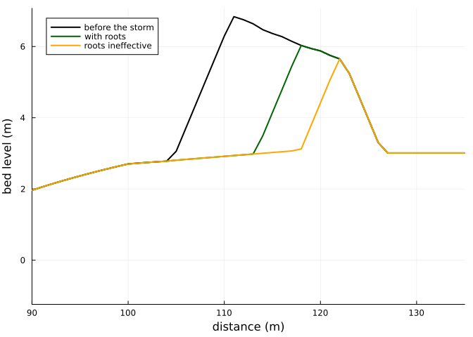

# A foredune built by marram grass
Simon Frost

- [Overview](#overview)
- [The beach and its weather](#the-beach-and-its-weather)
- [The dune](#the-dune)
- [The plants](#the-plants)
- [How densely to plant](#how-densely-to-plant)
- [A storm](#a-storm)
- [What remains uncertain](#what-remains-uncertain)

## Overview

With `veg_model = marram`, every grid cell carries the marram grass
model of the [previous vignette](../13_marram_grass/13_marram_grass.md),
and the plants and the bed are coupled both ways:

- **Plants shape the wind.** Each time step, shoot density and canopy
  height give a frontal area. That frontal area becomes the effective
  cover in AeoLiS’s shear reduction,
  `1 / sqrt(1 + gamma_vegshear rhoveg)`. The shoots bend in strong wind,
  so the cover depends on the current wind speed ([Laporte-Fauret et al.
  2024](#ref-LaporteFauret2024); [Walter et al. 2012](#ref-Walter2012)).
- **The bed shapes the plants.** Every `veg_interval` (a day), each cell
  is advanced using:
  - the rate of bed-level change since the last update, as burial;
  - the fraction of the interval it spent under water;
  - rainfall and evapotranspiration from `veg_water_file`;
  - the day of the year from `refdate`.
- **Plants spread.** Bare cells are colonised from occupied neighbours
  at about 0.4 m per year ([Keijsers et al. 2015](#ref-Keijsers2015)),
  with occasional jumps ([Bonte et al. 2021](#ref-Bonte2021)).
- **Roots resist waves.** When a storm cuts back the dune, sand in the
  rooted layer costs more of the waves’ work to remove than bare sand
  ([Figlus et al. 2014](#ref-Figlus2014); [De Battisti and Griffin
  2020](#ref-DeBattisti2020)).

``` julia
ENV["GKSwstype"] = "100"
using Aeolis
using Plots
using Printf
using Random
```

## The beach and its weather

A transect rises from below the low-tide line to a backshore at 3 m, 100
m inland. Beyond 126 m the hinterland is fixed, so the bare sand behind
the dune does not blow away. There is a semidiurnal tide of 1 m. Every
day has a new onshore wind: a Weibull speed with a mean of 7 m/s, from
directions within 40° of shore-normal. Rain falls on 45 % of days, and
potential evapotranspiration follows the seasons. The weather is drawn
from a seeded random number generator, so the vignette is reproducible.

``` julia
day = 86400.0
years = 3
rng = Xoshiro(1)
x = collect(0.0:1.0:150.0)
zb0 = @. min(-1.0 + x / 25, 3.0)
nd = 365 * years + 1
td = (0:(nd - 1)) .* day
wind = hcat(td, [7.0 / 0.886 * sqrt(-log(rand(rng))) for _ in td],
            [270.0 + 80 * (rand(rng) - 0.5) for _ in td])
tt = collect(0.0:3600.0:(nd * day))
tide = hcat(tt, sin.(2pi .* tt ./ (12.42 * 3600)))
doy = [(k % 365) + 1 for k in 0:(nd - 1)]
water = hcat(td, [rand(rng) < 0.45 ? -4.9 * log(rand(rng)) : 0.0 for _ in td],
             @. 2.0 - 1.5 * cos(2pi * (doy - 15) / 365))
base = (; xgrid_file=x, bed_file=zb0, ne_file=(@. ifelse(x >= 126, zb0, -10.0)),
        th_nelayer=true, wind_file=wind, tide_file=tide, process_tide=true,
        grain_size=0.0003, dt=3600.0, tstop=years * 365day, output_times=30day,
        refdate="2020-01-01 00:00", process_avalanche=true,
        output_vars=[:zb, :veg_N, :hveg, :rhoveg, :veg_P, :veg_Gb, :veg_zdot])
nothing
```

Marram is planted between 110 and 125 m at 30 % of the density of a
closed stand, 141 shoots per m². The same beach is also run without
plants.

``` julia
planting = @. ifelse(110 <= x <= 125, 0.3, 0.0)
marram = solve(AeolisProblem(AeolisParameters(; base..., process_vegetation=true,
                                              veg_model=:marram, veg_file=planting,
                                              veg_water_file=water)); rng=Xoshiro(2))
bare = solve(AeolisProblem(AeolisParameters(; base...)))
nothing
```

## The dune

``` julia
z = transect(marram, :zb)
zbare = transect(bare, :zb)
volume(zz) = sum(max.(zz[101:end] .- 3.0, 0.0))     # m³ per m of beach, above 3 m
plt = plot(x, zbare[:, end]; color=:gray, lw=2, label="bare, year 3",
           xlabel="distance (m)", ylabel="bed level (m)", xlims=(80, 150), legend=:topleft)
for (k, c) in zip((13, 25, 37), (:lightgreen, :green, :darkgreen))
    plot!(plt, x, z[:, k]; lw=2, color=c, label="marram, year $((k - 1) ÷ 12)")
end
plot!(plt, x, zb0; color=:black, ls=:dash, label="initial")
plt
```



``` julia
for k in (13, 25, 37)
    @printf("year %d: dune volume %.1f m³/m with marram, %.1f m³/m bare; crest %.2f m\n",
            (k - 1) ÷ 12, volume(z[:, k]), volume(zbare[:, k]), maximum(z[:, k]))
end
```

    year 1: dune volume 20.1 m³/m with marram, 0.3 m³/m bare; crest 4.81 m
    year 2: dune volume 35.7 m³/m with marram, 0.3 m³/m bare; crest 5.78 m
    year 3: dune volume 53.6 m³/m with marram, 0.3 m³/m bare; crest 6.80 m

The bare beach builds no dune: sand blown off the beach crosses the flat
backshore. The planted strip slows the wind at the bed, traps the sand
and grows a dune several metres high in three years. The wind blows
onshore every day here, so this rate is high for a real coast.

## The plants

``` julia
N = transect(marram, :veg_N)
months = (0:(size(N, 2) - 1))
heatmap(months, x[95:135], N[95:135, :]; xlabel="months", ylabel="distance (m)",
        colorbar_title="shoots per m²", c=:Greens)
```



Shoot density rises each summer and falls back each winter.

- **Seaward edge:** the stand spreads over the bare beach a little each
  year, which is as much as the front speed allows.
- **Crest:** the stand thins where the dune grows fastest.

The diagnostics at the end of the run show why:

``` julia
G = transect(marram, :veg_Gb)
zdot = transect(marram, :veg_zdot)
tr = MarramTraits()
for i in 106:4:126
    @printf("x = %3d m: bed %.2f m, burial %5.2f m/season, G_b %.2f, shoots %3.0f per m²\n",
            x[i], z[i, end], zdot[i, end] * Aeolis.season_length(tr), G[i, end], N[i, end])
end
```

    x = 105 m: bed 3.03 m, burial  0.47 m/season, G_b 0.82, shoots   0 per m²
    x = 109 m: bed 5.62 m, burial  0.50 m/season, G_b 0.77, shoots 199 per m²
    x = 113 m: bed 6.60 m, burial  0.72 m/season, G_b 0.30, shoots  30 per m²
    x = 117 m: bed 6.12 m, burial  0.50 m/season, G_b 0.77, shoots 126 per m²
    x = 121 m: bed 5.73 m, burial  0.34 m/season, G_b 0.99, shoots 259 per m²
    x = 125 m: bed 3.95 m, burial -0.04 m/season, G_b 0.98, shoots 414 per m²

Where the crest is buried by about 0.7 m per growing season, more than
twice the optimum ([<span class="nocase">Nolet et al.</span>
2018](#ref-Nolet2018)), the burial multiplier `G_b` falls to about 0.3.
Fewer shoots survive there than on the flanks. The landward edge
receives little sand. The model would slowly lower vigour there through
soil-biota pressure, but three years is too short for that to show.

## How densely to plant

The stand is planted at densities from 2 % to 100 % of a closed stand,
and run for two years:

``` julia
for c in (0.02, 0.1, 1.0)
    p = AeolisParameters(; base..., tstop=2 * 365day, output_times=365day,
                         process_vegetation=true, veg_model=:marram,
                         veg_file=(@. ifelse(110 <= x <= 125, c, 0.0)),
                         veg_water_file=water)
    zz = transect(solve(AeolisProblem(p); rng=Xoshiro(2)), :zb)
    @printf("planted at %4.0f %%: dune volume %.1f m³/m after two years\n", 100c,
            volume(zz[:, end]))
end
```

    planted at    2 %: dune volume 33.1 m³/m after two years
    planted at   10 %: dune volume 34.4 m³/m after two years
    planted at  100 %: dune volume 38.0 m³/m after two years

Even a sparse planting builds most of the dune, for two reasons:

- **Shelter saturates.** The drag on full-height marram reaches its cap
  at about 45 shoots per m².
- **Sparse stands fill in.** They grow toward their capacity within a
  season or two.

Bonte et al. ([2021](#ref-Bonte2021)) found that dunes grow fastest at
intermediate cover. The model does not reproduce this, either here or in
two-dimensional runs with patchy planting, where dune volume also rose
with the area planted. Why the two differ is not yet understood. The
supply of sand, the measure of dune growth, and how trapping depends on
cover in their cellular model are candidates.

## A storm

After the three years, a storm attacks the dune for two days. A surge of
2.5 m and waves 3 m high with a 10 s period collide with the dune face,
which erodes as in Palmsten and Holman ([2012](#ref-Palmsten2012)).

The storm run starts from the state after three years (`u0`), so the
roots are those the dune grew. It is repeated with the roots made
ineffective: a traits file sets the strength of bare sand, `tau0`, so
high that reinforcement adds nothing. The light wind moves no sand.

The dune toe is set at 2.7 m. AeoLiS takes as the toe the point of the
profile nearest that elevation, and the hinterland lies at exactly 3 m.

``` julia
t0 = years * 365day
storm = (; tstart=t0, tstop=t0 + 2day, output_times=2day,
         wind_file=[0.0 2.0 270.0; 4000day 2.0 270.0], tide_file=[0.0 2.5; 4000day 2.5],
         wave_file=[0.0 3.0 10.0; 4000day 3.0 10.0], process_wave=true, process_runup=true,
         process_dune_erosion=true, dune_toe_elevation=2.7, beach_slope=0.04)
inert = tempname() * ".toml"
write(inert, "tau0 = 1e12\n")
u3 = marram.u
eroded = Dict{String,Float64}()
plt = plot(x, u3.zb[:, 2]; color=:black, lw=2, label="before the storm",
           xlabel="distance (m)", ylabel="bed level (m)", xlims=(90, 135), legend=:topleft)
for (label, kw, c) in (("with roots", (;), :darkgreen), ("roots ineffective", (; veg_traits_file=inert), :orange))
    p = AeolisParameters(; base..., storm..., process_vegetation=true, veg_model=:marram,
                         veg_file=planting, kw...)
    z1 = solve(AeolisProblem(p; u0=u3); rng=Xoshiro(3)).u.zb[:, 2]
    eroded[label] = sum(max.(u3.zb[:, 2] .- z1, 0.0))
    plot!(plt, x, z1; lw=2, color=c, label=label)
end
@printf("eroded: %.1f m³/m with roots, %.1f m³/m without; %.0f %% less\n",
        eroded["with roots"], eroded["roots ineffective"],
        100 * (1 - eroded["with roots"] / eroded["roots ineffective"]))
plt
```

    eroded: 29.7 m³/m with roots, 42.6 m³/m without; 30 % less



The roots keep a third of the dune face that the storm would otherwise
take. Flume experiments found 8-37 % less erosion with vegetation
([Figlus et al. 2014](#ref-Figlus2014); [Kosmalla et al.
2026](#ref-Kosmalla2026)), and intact cores of marram 36 % ([De Battisti
and Griffin 2020](#ref-DeBattisti2020)). The fine-root fraction of the
traits was fitted to these, and the run falls in their range.

The model does not represent one effect seen in a large flume ([Feagin
et al. 2023](#ref-Feagin2023)): a vegetated dune that eroded faster,
because plants changed the run-up and infiltration of the swash.

## What remains uncertain

- **The burial response and soil-biota pressure** rest on few studies.
- **Root reinforcement:** the tensile strength of marram roots has not
  been measured, and the erosion data constrain only its product with
  the fine-root fraction.

Both uncertainties are listed with ranges in `marram_info`.

<div id="refs" class="references csl-bib-body hanging-indent">

<div id="ref-Bonte2021" class="csl-entry">

Bonte, Dries, Femke Batsleer, Sam Provoost, et al. 2021. “Biomorphogenic
Feedbacks and the Spatial Organization of a Dominant Grass Steer Dune
Development.” *Frontiers in Ecology and Evolution* 9: 761336.
<https://doi.org/10.3389/fevo.2021.761336>.

</div>

<div id="ref-DeBattisti2020" class="csl-entry">

De Battisti, Davide, and John N. Griffin. 2020. “Below-Ground Biomass of
Plants, with a Key Contribution of Buried Shoots, Increases Foredune
Resistance to Wave Swash.” *Annals of Botany* 125: 325–34.
<https://doi.org/10.1093/aob/mcz125>.

</div>

<div id="ref-Feagin2023" class="csl-entry">

Feagin, Rusty A., Rachel A. Innocenti, Hailey Bond, et al. 2023. “Does
Vegetation Accelerate Coastal Dune Erosion During Extreme Events?”
*Science Advances* 9: eadg7135.
<https://doi.org/10.1126/sciadv.adg7135>.

</div>

<div id="ref-Figlus2014" class="csl-entry">

Figlus, Jens, Jacob M. Sigren, Anna R. Armitage, and Robert C. Tyler.
2014. “Erosion of Vegetated Coastal Dunes.” *Coastal Engineering
Proceedings* 1 (34): sediment.20.
<https://doi.org/10.9753/icce.v34.sediment.20>.

</div>

<div id="ref-Keijsers2015" class="csl-entry">

Keijsers, Joep G. S., Alma V. De Groot, and Michel J. P. M. Riksen.
2015. “Vegetation and Sedimentation on Coastal Foredunes.”
*Geomorphology* 228: 723–34.
<https://doi.org/10.1016/j.geomorph.2014.10.027>.

</div>

<div id="ref-Kosmalla2026" class="csl-entry">

Kosmalla, Viktoria, Oliver Lojek, Lukas Ahrenbeck, et al. 2026.
“Vegetation Effects on Dune Erosion Under Wave Collision: Influence of
Planting Density, Biomass Distribution and Arrangement in Scaled
Experiments.” *Coastal Engineering* 204: 104899.
<https://doi.org/10.1016/j.coastaleng.2025.104899>.

</div>

<div id="ref-LaporteFauret2024" class="csl-entry">

Laporte-Fauret, Quentin, Meagan Wengrove, Peter Ruggiero, et al. 2024.
“A New Approach to Account for Species-Specific Sand Capture by Plants
in an Aeolian Sediment Transport and Coastal Dune Building Model.”
*Journal of Geophysical Research: Earth Surface* 129: e2024JF007867.
<https://doi.org/10.1029/2024JF007867>.

</div>

<div id="ref-Nolet2018" class="csl-entry">

<span class="nocase">Nolet, Corjan, Marinka van Puijenbroek, Juha
Suomalainen, Juul Limpens, and Michel Riksen</span>. 2018. “UAV-Imaging
to Model Growth Response of Marram Grass to Sand Burial: Implications
for Coastal Dune Development.” *Aeolian Research* 31: 50–61.
<https://doi.org/10.1016/j.aeolia.2017.08.006>.

</div>

<div id="ref-Palmsten2012" class="csl-entry">

Palmsten, Margaret L., and Robert A. Holman. 2012. “Laboratory
Investigation of Dune Erosion Using Stereo Video.” *Coastal Engineering*
60: 123–35. <https://doi.org/10.1016/j.coastaleng.2011.09.003>.

</div>

<div id="ref-Walter2012" class="csl-entry">

Walter, Benjamin, Christof Gromke, and Michael Lehning. 2012.
“Shear-Stress Partitioning in Live Plant Canopies and Modifications to
Raupach’s Model.” *Boundary-Layer Meteorology* 144: 217–41.
<https://doi.org/10.1007/s10546-012-9719-4>.

</div>

</div>
